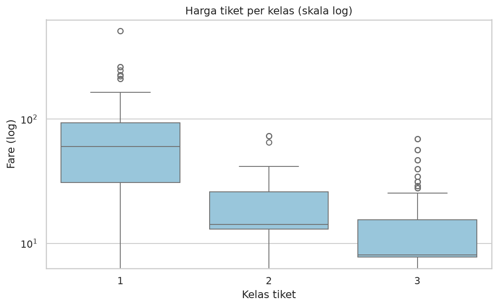
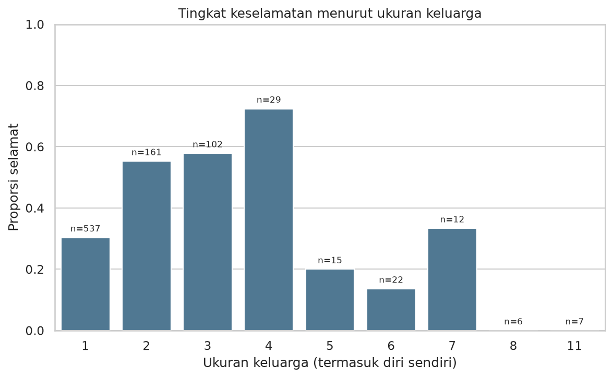

# Capstone — Jalur A: EDA Dataset Publik (Titanic)

> Contoh pengerjaan lengkap untuk **Modul 6 (versi 2), Jalur A**. Data nyata (seaborn-data); semua angka di bawah dihitung oleh `src/main.py`.

## 1. Latar belakang & motivasi

Tenggelamnya Titanic (1912) adalah dataset klasik untuk latihan EDA: ada missing value, variabel kategorik dan numerik, serta pertanyaan yang mudah dipahami orang awam — siapa yang lebih mungkin selamat, dan mengapa pola itu muncul.

## 2. Pertanyaan analisis

1. Faktor apa (jenis kelamin, kelas tiket, usia, ukuran keluarga, harga tiket) yang paling berkaitan dengan keselamatan?
2. Apakah kelas tiket dan jenis kelamin saling memperkuat atau berdiri sendiri?
3. Apakah anak-anak dan keluarga kecil punya peluang selamat yang berbeda dari penumpang lain?

## 3. Data (sumber, ukuran, cara dapat, etika)

- **Sumber:** `titanic.csv` dari repositori [seaborn-data](https://github.com/mwaskom/seaborn-data); salinan lokal di `data/raw/titanic.csv` (diunduh otomatis jika belum ada).
- **Ukuran:** 891 baris × 15 kolom. Kosong: `age` 177 (19,9%), `deck` 688 (77,2%), `embarked`/`embark_town` masing-masing 2; 107 baris identik penuh.
- **Etika:** data historis publik tanpa informasi pribadi sensitif; dipakai untuk edukasi.

## 4. Metode (cleaning, analisis, tools)

- **Cleaning** (terdokumentasi pada output `run_log.txt` dan `data/processed/data_bersih.csv`): `age` diisi median per (kelas, jenis kelamin) + penanda `age_imputed`; `embarked` diisi modus; `deck` kosong → kategori "Unknown"; kolom redundan `alive` dan `class` dihapus. **107 baris identik tidak dihapus** karena tidak ada ID penumpang.
- **Fitur baru:** `family_size`, `age_group`, `fare_quartile`, `status`.
- **Analisis:** 6 agregasi `groupby` (jenis kelamin, kelas, kelompok usia, ukuran keluarga, pelabuhan, fare per kelas) + `pivot_table` jenis kelamin × kelas + matriks korelasi + uji chi-square dan Mann-Whitney.
- **Tools:** pandas, numpy, matplotlib, seaborn, scipy, openpyxl.

## 5. Hasil utama (temuan + rujukan figure)

1. Jenis kelamin adalah pembeda terkuat. 74.2% penumpang perempuan selamat, dibanding 18.9% laki-laki (selisih 55 poin persentase; chi-square p = 1.2e-58).

2. Kelas tiket memengaruhi peluang selamat. Kelas 1: 63.0%, kelas 2: 47.3%, kelas 3: 24.2% (chi-square p = 4.5e-23). Korelasi pclass dengan survived = -0.34.

3. Efek kelas dan jenis kelamin saling menguatkan. Perempuan kelas 1 selamat 96.8%, sedangkan laki-laki kelas 3 hanya 13.5%. Namun perempuan kelas 3 (50.0%) masih lebih baik daripada laki-laki kelas 1 (36.9%).

4. Anak-anak diprioritaskan. Kelompok usia 0-12 tahun selamat 58.0% (n=69), lebih tinggi daripada dewasa muda 19-35 tahun (35.8%) dan lansia 60+ (22.7%).

5. Ukuran keluarga berhubungan non-linier dengan keselamatan. Penumpang sendirian selamat 30.4%, keluarga 2-4 orang 57.9%, dan keluarga >= 5 orang hanya 16.1% (n=62).

6. Harga tiket berkorelasi positif dengan keselamatan. Median fare kelas 1 = 60.3 vs kelas 3 = 8.1; penumpang yang selamat membayar lebih mahal (Mann-Whitney p = 4.6e-22; korelasi fare-survived = 0.26).

Rujukan figure: butir 1–3 → `figures/01_keselamatan_kelas_sex.png`; butir 4 → `figures/02_distribusi_usia.png` dan `06_usia_dan_sex.png`; butir 5 → `figures/05_ukuran_keluarga.png`; butir 6 → `figures/03_harga_tiket_per_kelas.png` dan `04_korelasi.png`.

Ringkasan tabel: `output/ringkasan.csv`, `output/pivot_sex_kelas.csv`, laporan Excel multi-sheet `output/laporan_titanic.xlsx`, dan teks lengkap di `output/insight.txt`.

## 6. Visualisasi (daftar figure + arti singkat)

| Figure | Arti singkat |
|---|---|
|  | Perempuan selamat jauh lebih sering di semua kelas; selisih terbesar pada kelas 2. |
|  | Anak kecil lebih banyak yang selamat; puncak usia 20–30 tahun didominasi yang tidak selamat. |
|  | Harga tiket turun tajam dari kelas 1 ke 3 (skala log), dengan banyak outlier. |
|  | `pclass` (-0,34) dan `fare` (+0,26) adalah korelasi numerik terkuat dengan `survived`. |
|  | Keluarga 2–4 orang lebih sering selamat; penumpang sendirian dan keluarga besar lebih rendah. |
|  | Perempuan > laki-laki di semua kelompok usia, kecuali anak-anak (hampir setara). |

Dashboard 2×3: `figures/00_dashboard.png` (juga PDF).

## 7. Batasan

- Data observasional dari satu peristiwa: temuan menunjukkan asosiasi, bukan sebab-akibat.
- 177 nilai usia (19,9%) diimputasi dengan median per kelas & jenis kelamin sehingga sebaran usia sedikit lebih sempit dari aslinya.
- Kolom deck 77% kosong sehingga tidak dipakai sebagai faktor analisis.
- 107 baris identik dipertahankan karena tidak ada ID penumpang; jika sebenarnya duplikat, proporsi bisa bergeser tipis.
- Kelompok kecil (lansia n=22, keluarga >= 5 orang n=62) membuat persentasenya tidak stabil.
- Harga tiket (fare) berkorelasi kuat dengan kelas tiket, sehingga efeknya tidak independen.

## 8. Kesimpulan & kerja lanjutan

Jenis kelamin dan kelas tiket adalah dua faktor terkuat dan saling memperkuat; anak-anak juga diprioritaskan. Ukuran keluarga dan harga tiket memberi gambaran tambahan, tetapi harga tiket sendiri berkorelasi kuat dengan kelas (pclass–fare = -0,55) sehingga tidak sepenuhnya independen. Semua temuan adalah asosiasi, bukan sebab-akibat.

Kerja lanjutan: model sederhana (logistic regression) untuk memperkirakan peluang selamat; imputasi usia yang lebih baik; analisis interaksi usia × kelas.

## 9. Cara menjalankan

```bash
pip install -r requirements.txt
python src/main.py
```

Log eksekusi: `output/run_log.txt`. Program dapat dijalankan dari folder mana pun.

## 10. Struktur folder

```text
jalur_a_eda_titanic/
├── README.md
├── requirements.txt
├── data/
│   ├── raw/titanic.csv
│   └── processed/data_bersih.csv
├── src/main.py
├── figures/                 # 6 PNG + dashboard (PNG/PDF)
└── output/
    ├── ringkasan.csv  pivot_sex_kelas.csv  laporan_titanic.xlsx
    ├── insight.txt
    └── run_log.txt
```

## 11. Bahan belajar

**Terkait modul:** Modul 4 (Pandas) dan Modul 5 (Matplotlib/Seaborn).

**Urutan membaca kode:** `main()` → `load_data` → `inspeksi` → `cleaning` → `analisis` → `visualisasi` → `tulis_insight` → `export`. Baca `run_log.txt` lebih dulu untuk melihat hasil tiap tahap, lalu cocokkan dengan fungsi yang menghasilkannya.

**Latihan lanjutan:**
1. Ganti imputasi `age` (median per kelas & jenis kelamin) dengan median global. Apakah insight berubah? Mengapa?
2. Tambahkan grafik ke-7 yang menjawab pertanyaan nomor 3 (anak-anak vs keluarga kecil).
3. Ganti dataset dengan `penguins` atau `tips` dari seaborn-data; fungsi mana yang harus diubah dan mana yang bisa dipakai ulang?
