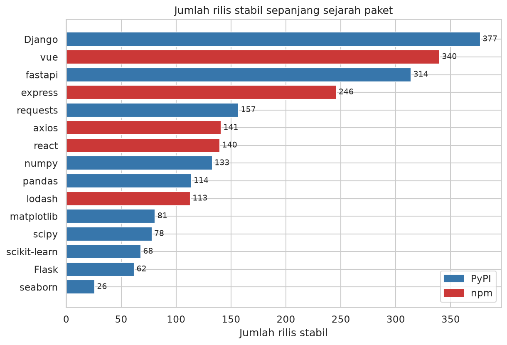
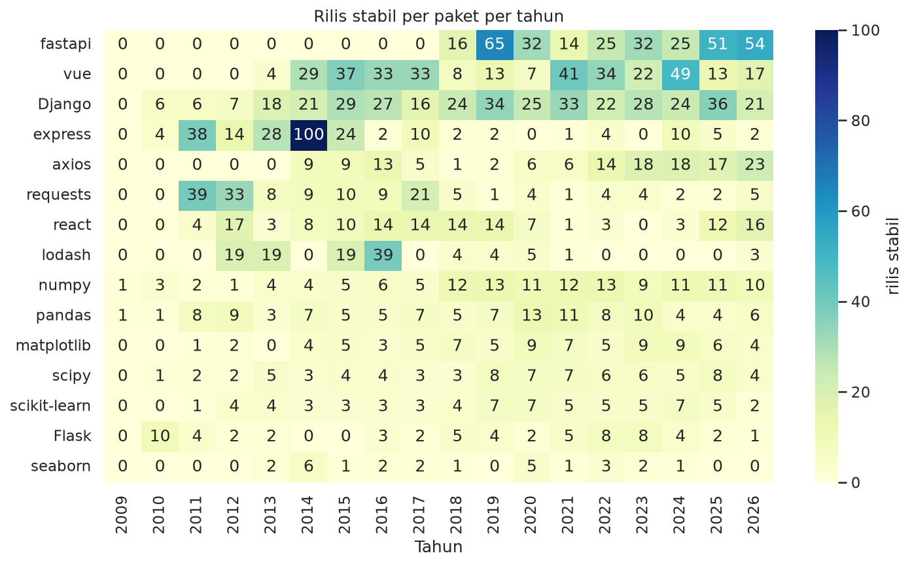

# Capstone — Jalur B: API → Analisis → Visualisasi (PyPI vs npm)

> Contoh pengerjaan lengkap untuk **Modul 6 (versi 2), Jalur B**. Data nyata diambil **langsung dari API publik** PyPI dan npm pada **2026-10-02**; angka dihitung oleh `src/main.py`.

## 1. Latar belakang & motivasi

Library populer dirilis dengan ritme yang sangat berbeda. Memahami ritme itu membantu memilih library dan merencanakan pembaruan dependensi. Proyek ini memakai API publik sebagai sumber data agar pipeline-nya mencerminkan pekerjaan nyata (ambil → simpan mentah → olah → visualisasi).

## 2. Pertanyaan analisis

1. Library mana yang paling aktif dirilis per tahun (bukan sekadar total sepanjang masa)?
2. Apakah ritme rilis library Python (PyPI) berbeda dari library JavaScript (npm) pada sampel ini?
3. Seberapa besar pre-release/build otomatis memengaruhi gambaran jumlah rilis?

## 3. Data (sumber, ukuran, cara dapat, etika)

- **Sumber:** PyPI JSON API (`https://pypi.org/pypi/<paket>/json`) untuk pandas, numpy, matplotlib, seaborn, scipy, requests, flask, django, fastapi, scikit-learn; npm registry (`https://registry.npmjs.org/<paket>`) untuk react, vue, express, lodash, axios.
- **Ukuran:** 15 paket, 5.703 rilis mentah → 5.697 baris bersih → 2.390 rilis stabil dipakai untuk analisis irama.
- **Cara dapat:** `requests.get` dengan `timeout`, 3× percobaan dengan jeda bertambah, cache file (24 jam), dan fallback ke cache lama bila API gagal. Hanya field yang diperlukan disimpan (respons npm penuh bisa >7 MB).
- **Waktu pengambilan:** 2026-10-02 (tersimpan pada `fetched_at` di tiap cache `data/raw/cache/*.json`).
- **Etika:** API publik tanpa autentikasi; diberi `User-Agent`, satu permintaan per paket, dan cache agar tidak membebani server.

## 4. Metode (cleaning, analisis, tools)

- **Ambil data:** fungsi generik `ambil_json(url, cache_file, ...)`; gabungkan dua sumber ke satu DataFrame.
- **Cleaning:** parsing waktu UTC; buang 6 baris tanpa tanggal valid dan 0 duplikat; tandai 3.299 versi pre-release (aturan PEP 440 untuk PyPI, tanda `-` untuk semver npm) dan 9 versi yanked; analisis irama memakai rilis stabil non-yanked.
- **Analisis:** jumlah rilis, median/P90 jarak antar rilis, rilis per tahun (dinormalisasi umur paket), pivot paket × tahun, perbandingan ekosistem, tren ukuran distribusi PyPI.
- **Tools:** requests, pandas, numpy, matplotlib, seaborn, packaging, openpyxl.

## 5. Hasil utama (temuan + rujukan figure)

1. Django punya rilis stabil terbanyak (377), tetapi fastapi paling aktif per tahun (40.2 rilis/tahun) sedangkan seaborn paling jarang (2.0/tahun). Jumlah total dipengaruhi umur paket, sehingga rilis per tahun lebih adil untuk membandingkan.

2. Jarak antar rilis sangat bervariasi. Median tercepat: Django (0.1 hari), terlama: seaborn (93.2 hari). Untuk Django, 52% interval antar rilis kurang dari 1 hari karena beberapa cabang dukungan dirilis bersamaan (rilis keamanan), sehingga mediannya mendekati nol. Pandas memiliki 114 rilis stabil dengan median 35.5 hari.

3. Perbandingan ekosistem: median rilis per paket per tahun di PyPI = 6.1 vs npm = 11.7; median jarak antar rilis PyPI = 18.4 hari vs npm = 5.8 hari (sampel hanya 10 paket PyPI dan 5 paket npm, jadi bukan generalisasi ekosistem).

4. Tahun 2014 adalah tahun dengan rilis stabil terbanyak (203 rilis dari seluruh paket yang dipantau; express sendiri menyumbang 100); pada tahun penuh terakhir (2025) total rilis = 172.

5. Proporsi pre-release berbeda jauh: PyPI 9.0% vs npm 76.3% dari seluruh versi terdaftar. Angka npm didominasi react: 95% versinya pre-release (2819 versi, 70% di antaranya build canary/experimental/nightly/dev).

6. Paket dengan rilis terakhir paling lama: seaborn (981 hari sebelum tanggal pengambilan data), sedangkan paling baru: fastapi (2 hari).

7. Ukuran distribusi NumPy (median per rilis) berubah dari 126.60 MB (2015) menjadi 901.74 MB (2026); median jumlah file per rilis naik dari 13 menjadi 72 (makin banyak wheel per platform/versi Python).

Rujukan figure: butir 1 → `figures/01_jumlah_rilis_per_paket.png`; butir 2 → `02_median_interval_rilis.png`; butir 3 → `02` dan `04_kumulatif_rilis.png`; butir 4 → `03_heatmap_rilis_per_tahun.png`; butir 7 → `05_ukuran_distribusi_pypi.png`.

Tabel: `output/ringkasan.csv`, `output/laporan_rilis.xlsx`; teks lengkap: `output/insight.txt`.

## 6. Visualisasi (daftar figure + arti singkat)

| Figure | Arti singkat |
|---|---|
|  | Django dan vue punya rilis stabil terbanyak; seaborn paling sedikit. |
|  | Median jarak antar rilis berkisar dari hitungan jam (Django) hingga ±93 hari (seaborn). |
|  | Lonjakan khas: express (100 rilis di 2014) dan fastapi yang aktif sejak 2018. |
|  | fastapi dan Django naik paling curam; seaborn hampir datar. |
|  | Ukuran total file per rilis membesar karena makin banyak wheel per platform. |

## 7. Batasan

- Sampel hanya 10 paket PyPI dan 5 paket npm — bukan mewakili seluruh ekosistem.
- Jumlah rilis mencerminkan kebijakan versi tiap proyek (mis. rilis keamanan serentak di Django, build canary di react), bukan kualitas atau popularitas.
- Data adalah snapshot pada waktu pengambilan; hasil dapat berbeda jika dijalankan ulang di waktu lain.
- Waktu rilis PyPI memakai upload file pertama per versi; npm memakai stempel waktu publish versi.
- Tanpa data unduhan, hubungan antara ritme rilis dan popularitas tidak dapat disimpulkan.

## 8. Kesimpulan & kerja lanjutan

Ritme rilis sangat bergantung pada gaya pengelolaan proyek: fastapi dan vue dirilis sangat sering, library ilmiah (numpy, pandas, scipy) rilis tiap beberapa minggu, sedangkan seaborn jarang. Pada sampel ini npm lebih sering merilis daripada PyPI, tetapi dengan 15 paket itu tidak boleh digeneralisasi. Menghitung "rilis per tahun" dan memisahkan pre-release/build otomatis mengubah gambaran secara signifikan.

Kerja lanjutan: tambahkan data unduhan; tambah paket/ekosistem; bedakan rilis mayor/minor/patch; jadwalkan pengambilan berkala.

## 9. Cara menjalankan

```bash
pip install -r requirements.txt
python src/main.py             # memakai cache bila < 24 jam
python src/main.py --refresh   # paksa ambil ulang dari API
```

Butuh internet untuk pengambilan pertama. Log eksekusi: `output/run_log.txt`.

## 10. Struktur folder

```text
jalur_b_api_pypi_npm/
├── README.md
├── requirements.txt
├── data/
│   ├── raw/cache/                # respons API versi ringkas (JSON per paket)
│   ├── raw/rilis_mentah.csv      # semua rilis gabungan, belum dibersihkan
│   └── processed/rilis_bersih.csv
├── src/main.py
├── figures/                      # 5 PNG
└── output/
    ├── ringkasan.csv  laporan_rilis.xlsx
    ├── insight.txt
    └── run_log.txt
```

## 11. Bahan belajar

**Terkait modul:** Modul 5 (API & JSON), Modul 2 (error handling, file).

**Urutan membaca kode:** `ambil_json` (timeout, retry, cache, fallback) → `kumpulkan_data` → `buat_dataframe` → `cleaning` → `analisis` → `visualisasi` → `tulis_insight`. Perhatikan folder `data/raw/cache/`: program tetap jalan walau API gagal.

**Latihan lanjutan:**
1. Matikan koneksi (atau ubah URL jadi salah) dan jalankan ulang. Bagian mana yang menyelamatkan program?
2. Tambahkan satu paket PyPI dan satu paket npm pilihanmu; adakah kolom yang perlu dibersihkan secara khusus?
3. Buat figure baru: median interval rilis per tahun untuk 3 paket teratas.
