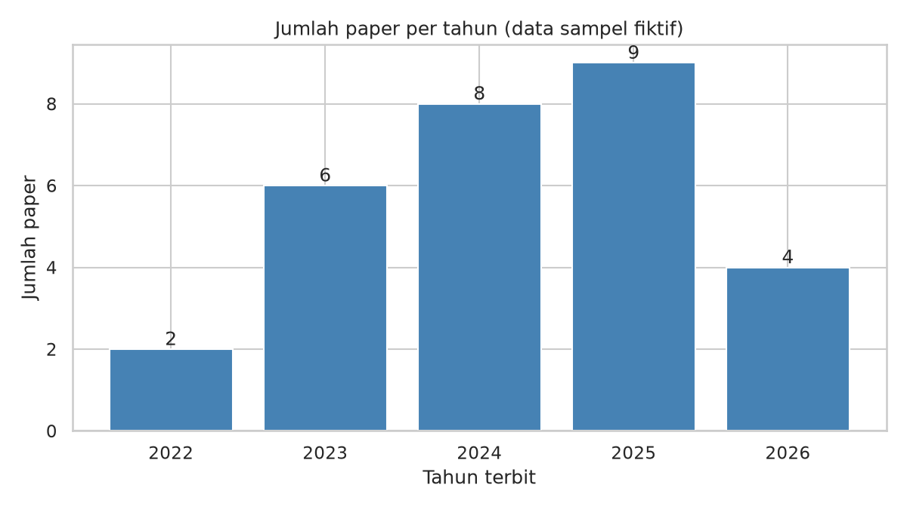
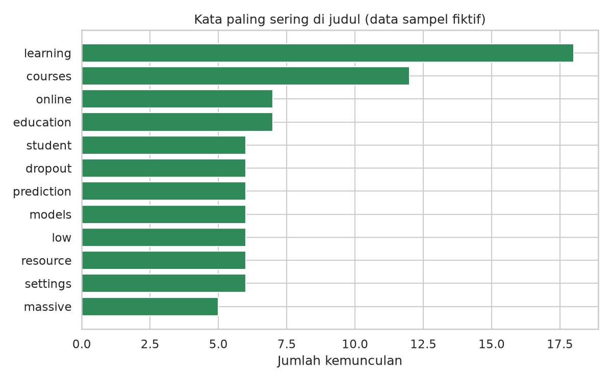
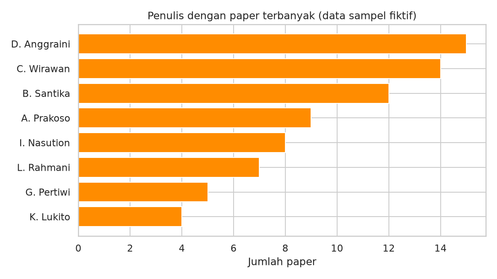

# Capstone — Jalur C: arXiv / Literatur + Ringkasan Kuantitatif

> Contoh pengerjaan untuk **Modul 6 (versi 2), Jalur C**.
>
> ⚠️ **Data pada contoh ini adalah SAMPEL FIKTIF, bukan hasil arXiv sebenarnya.** API arXiv (`export.arxiv.org`) diblokir di lingkungan tempat contoh ini dibuat (HTTP 403), sehingga program otomatis memakai `data/raw/arxiv_sample.xml` yang dibuat acak oleh `src/buat_sampel.py` (tautan memakai `example.org`). Kode, alur, dan format output adalah yang akan Anda pakai; **angka dan temuan pada output ini hanya untuk memahami pipeline**. Jalankan di komputer dengan internet untuk mendapat hasil nyata.

## 1. Latar belakang & motivasi

Mahasiswa pascasarjana sering perlu memetakan literatur: seberapa cepat topik berkembang, kata kunci apa yang dominan, dan siapa penulis yang berulang. Proyek ini membangun pipeline kecil untuk itu dari metadata arXiv.

## 2. Pertanyaan analisis

1. Bagaimana jumlah paper bertopik deep learning + education berkembang dari tahun ke tahun?
2. Kata/topik apa yang paling sering muncul di judul?
3. Siapa penulis yang paling sering muncul dan seberapa terkonsentrasi penulisnya?

## 3. Data (sumber, ukuran, cara dapat, etika)

- **Sumber (mode live):** arXiv API `http://export.arxiv.org/api/query` dengan query `all:"deep learning" AND all:education`, diurutkan `submittedDate` menurun.
- **Ukuran:** 3 halaman × 10 paper = 30 paper (≥ 20 sesuai scope minimum), paginasi dengan parameter `start`.
- **Cara dapat:** `requests.get` dengan `timeout`; jeda 3 detik antar halaman; XML mentah tiap halaman disimpan ke `data/raw/arxiv_halaman_N.xml` begitu berhasil (agar tidak perlu mengulang bila nanti gagal).
- **Fallback:** bila API gagal, program memakai data sampel fiktif dan **menandainya** pada judul grafik dan awal `insight.txt`.
- **Etika:** hanya metadata publik; jeda antar request sesuai pedoman arXiv; tidak ada scraping halaman web.

## 4. Metode (cleaning, analisis, tools)

- **Cleaning:** buang judul duplikat (1 pada sampel ini) dan baris tanpa tanggal valid; bentuk kolom `tahun` dan `n_penulis`.
- **Analisis:** jumlah paper per tahun, frekuensi kata judul (≥ 3 huruf, tanpa stopword), penulis teratas, rata-rata penulis per paper, konsentrasi tiga penulis teratas.
- **Tools:** requests, feedparser, pandas, matplotlib, seaborn.

## 5. Hasil utama (temuan + rujukan figure)

**Perhatian:** dihitung dari data sampel fiktif.

1. Korpus: 29 paper, terbit 2022-10-05 s.d. 2026-08-20.
2. Tahun dengan paper terbanyak: 2025 (9 paper); tahun 2022 hanya 2, sehingga jumlah pada tahun penuh terakhir (2025) = 9 (≈ 4.5× tahun pertama).
3. Kata judul paling sering: 'learning' (18×) dan 'courses' (12×) — menandakan fokus topik pada kata tersebut.
4. Rata-rata 2.9 penulis per paper; penulis teratas D. Anggraini muncul di 15 paper.
5. Tiga penulis teratas menyumbang 41 dari 85 kemunculan nama penulis (48%) — indikasi tingkat konsentrasi penulis pada korpus ini.

Rujukan figure: butir 2 → `figures/01_paper_per_tahun.png`; butir 3 → `figures/02_kata_judul.png`; butir 4–5 → `figures/03_penulis_teratas.png`.

Tabel: `output/ringkasan.csv`, `output/kata_judul.csv`, `output/penulis_teratas.csv`; teks lengkap: `output/insight.txt`.

## 6. Visualisasi (daftar figure + arti singkat)

| Figure | Arti singkat |
|---|---|
|  | Jumlah paper per tahun terbit (judul grafik menandai bahwa ini data sampel fiktif). |
|  | Kata yang paling sering muncul pada judul. |
|  | Penulis dengan jumlah paper terbanyak pada korpus. |

## 7. Batasan

- Hanya metadata (judul, penulis, tanggal) — isi paper tidak dianalisis; kata judul tidak sama dengan topik sebenarnya.
- Hasil bergantung pada query: query berbeda akan menghasilkan korpus berbeda (bias query).
- Ukuran korpus kecil (30 paper) sehingga pola per tahun dan penulis tidak stabil secara statistik.
- Satu nama penulis dapat ditulis berbeda antar paper (tidak ada disambiguasi penulis).
- Tanggal 'published' adalah tanggal submit versi pertama, bukan tanggal publikasi jurnal.
- **Khusus contoh ini:** seluruh data fiktif; tidak ada kesimpulan tentang literatur sebenarnya yang dapat diambil.

## 8. Kesimpulan & kerja lanjutan

Pipeline lengkap dan teruji untuk alur paginasi → metadata → analisis waktu/kata/penulis → visualisasi → insight, termasuk penanganan kegagalan API dengan fallback yang dilabeli jelas. Untuk hasil nyata, jalankan dengan internet.

Kerja lanjutan: tambah analisis tren kata per tahun; gunakan abstrak (bukan hanya judul); bandingkan dua query; deduplikasi nama penulis.

## 9. Cara menjalankan

```bash
pip install -r requirements.txt
python src/main.py            # coba API arXiv; bila gagal pakai sampel fiktif
python src/main.py --offline  # langsung pakai sampel fiktif
python src/buat_sampel.py     # (opsional) membuat ulang data sampel fiktif
```

Log eksekusi (API gagal → fallback): `output/run_log.txt`.

## 10. Struktur folder

```text
jalur_c_arxiv/
├── README.md
├── requirements.txt
├── data/
│   ├── raw/arxiv_sample.xml      # SAMPEL FIKTIF (fallback)
│   ├── raw/paper_mentah.csv
│   └── processed/paper_bersih.csv
├── src/
│   ├── main.py
│   └── buat_sampel.py
├── figures/                      # 3 PNG
└── output/
    ├── ringkasan.csv  kata_judul.csv  penulis_teratas.csv
    ├── insight.txt
    └── run_log.txt
```

## 11. Bahan belajar

**Terkait modul:** Modul 5 (arXiv API, parsing XML), Modul 4 (groupby, teks).

**Urutan membaca kode:** `ambil_live` (paginasi + jeda) atau `ambil_sampel` → `parse_feed` → `cleaning` → `kata_judul` / `penulis_teratas` → `analisis` → `visualisasi`. Data bawaan adalah sampel fiktif: jalankan mode live untuk hasil nyata.

**Latihan lanjutan:**
1. Jalankan mode live dengan kata kunci bidang studimu dan bandingkan tren per tahun dengan sampel.
2. Tambahkan stop-words Indonesia/Inggris tambahan pada `kata_judul`. Bagaimana top-10 kata berubah?
3. Tambahkan analisis jumlah penulis per paper dan satu figure untuk itu.
