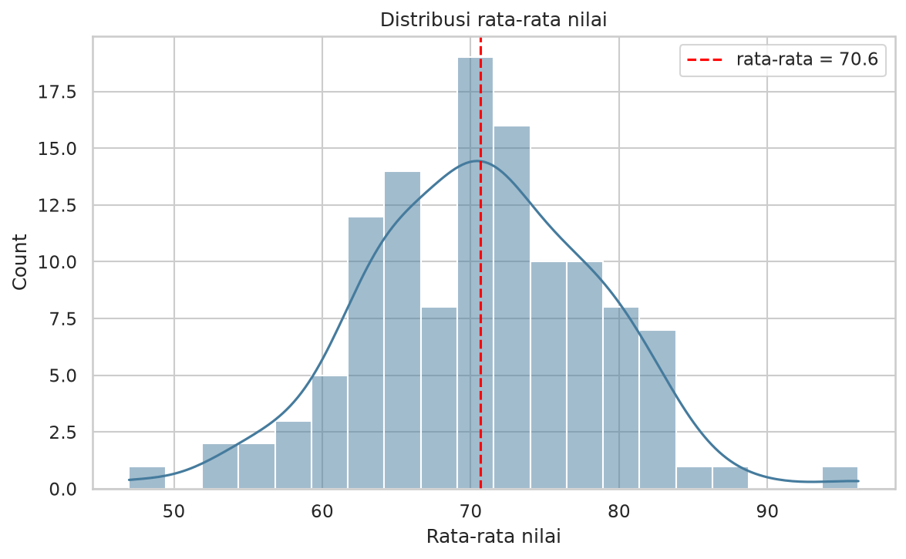
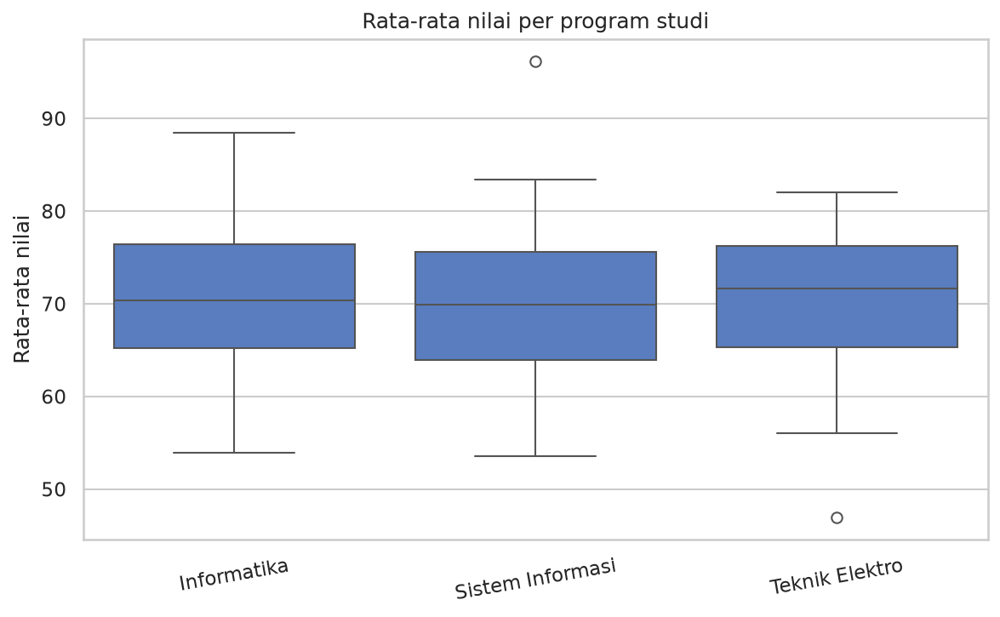
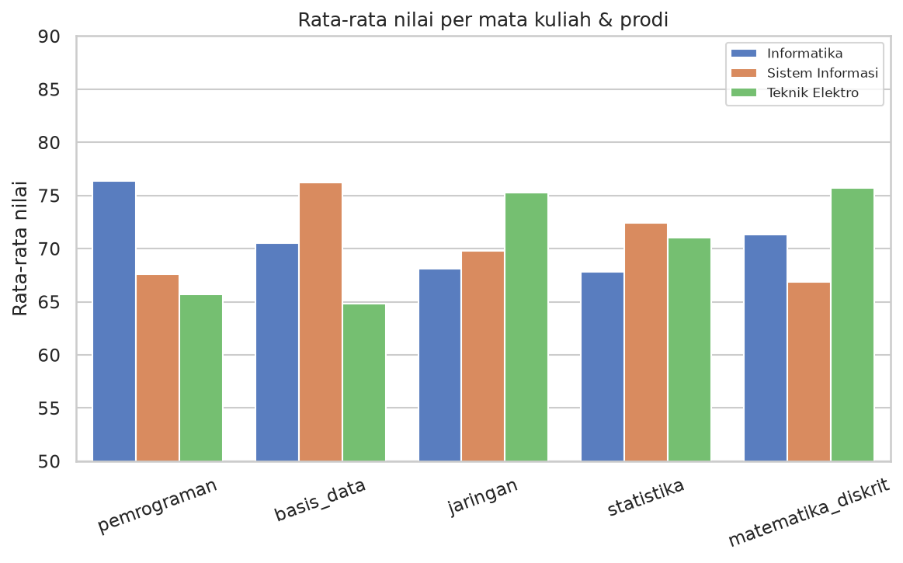
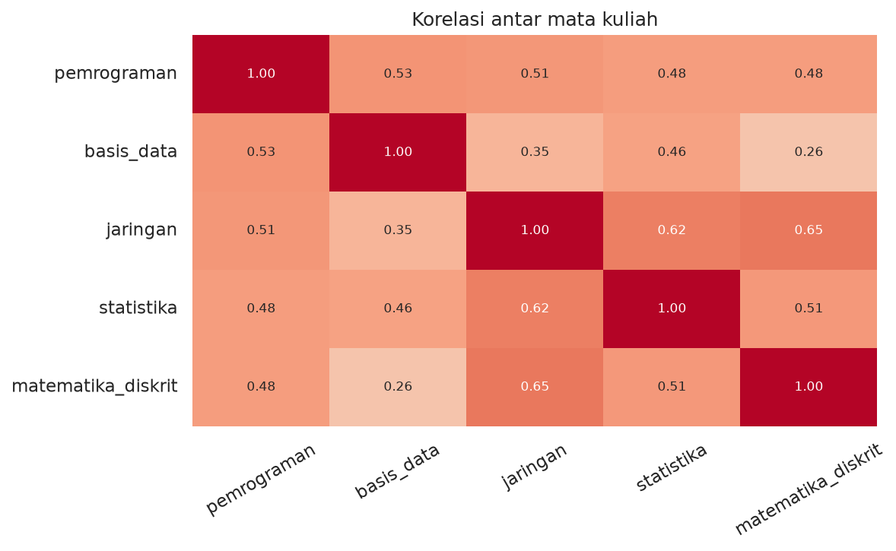
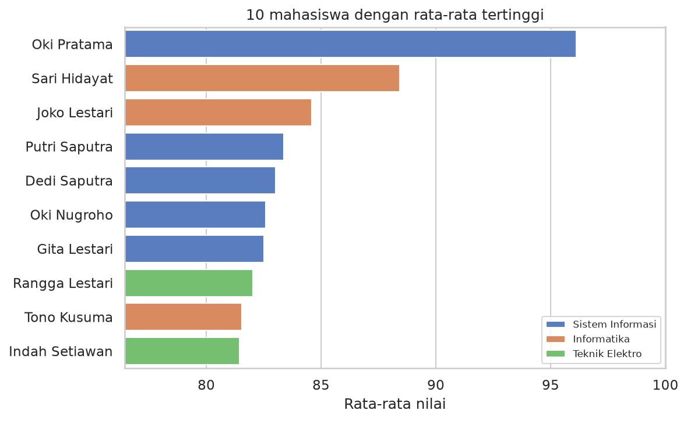
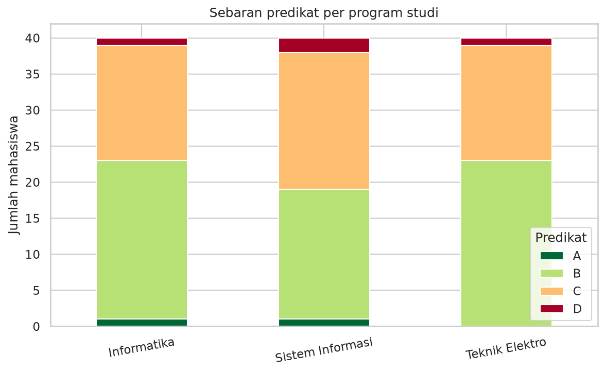

# Dokumentasi Capstone Project

## 1. Judul dan Identitas
- Judul: Aplikasi Analisis Nilai Akademik Berbasis OOP
- Nama: Contoh pengerjaan lengkap (Capstone Python Intensive Bootcamp)
- Jalur: D (Aplikasi Analisis Nilai) + stretch goals
- Tanggal: 2026-10-01

## 2. Latar Belakang / Masalah
Dosen/prodi perlu alat kecil untuk menjawab pertanyaan rutin: bagaimana sebaran nilai, siapa yang teratas, apakah ada perbedaan antar program studi, dan bagaimana menambah data baru dengan aman. Proyek ini membungkus semua kebutuhan itu dalam satu kelas yang dapat dipakai ulang.

## 3. Sumber Data
- Data **sintetis** 120 mahasiswa (3 prodi × 40), 5 mata kuliah: pemrograman, basis_data, jaringan, statistika, matematika_diskrit.
- Dibuat dari kemampuan dasar ~ N(70, 8) + bonus per prodi + noise N(0, 6), dipotong ke 0–100.
- Karena sintetis, temuan menggambarkan **cara kerja aplikasi**, bukan kondisi akademik nyata.

## 4. Metodologi / Alur Kerja
1. Desain kelas `AnalisisNilai` (atribut `df`, `matkul`) dan exception `DataTidakValidError`.
2. Validasi saat muat/tambah: kolom wajib, NIM unik, nilai 0–100, mata kuliah lengkap.
3. Fitur: `tambah_mahasiswa`, `statistik`, `statistik_per_prodi`, `filter`, `ranking`, `bandingkan_prodi` (Welch t-test), `visualisasi`, `export`, `simpan_state`/`muat_state`.
4. Pipeline otomatis di `main.py` dan mode menu terminal (`--interaktif`).
5. Pengujian: 7 unit test (valid/tidak valid, filter, ranking, state, file hilang, perbandingan).
6. Insight dihitung otomatis dari data (`tulis_insight`).

Penanganan error: `FileNotFoundError` dengan pesan jelas, `DataTidakValidError` untuk data salah, input non-angka di mode interaktif ditangkap tanpa menghentikan program, dan `EOFError` ditangani saat input habis.

## 5. Hasil dan Visualisasi
| Grafik | Penjelasan |
|---|---|
|  | Rata-rata nilai berbentuk lonceng di sekitar 70,6 dengan beberapa pencilan. |
|  | Median ketiga prodi hampir sama; ada pencilan tinggi di Sistem Informasi dan rendah di Teknik Elektro. |
|  | Tiap prodi unggul pada mata kuliah berbeda (pola yang tidak terlihat dari rata-rata keseluruhan). |
|  | Semua mata kuliah berkorelasi positif; jaringan–matematika_diskrit paling kuat. |
|  | Sepuluh teratas: 5 Sistem Informasi, 3 Informatika, 2 Teknik Elektro. |
|  | Predikat B dan C mendominasi di semua prodi; predikat A sangat jarang. |

Dashboard: `output/figures/00_dashboard.png`. Laporan Excel 5 sheet: `output/reports/laporan_nilai.xlsx` (Data, Statistik, Per prodi, Top 20, Predikat).

## 6. Insight dan Temuan
1. **Program studi dengan rata-rata tertinggi: Informatika** (70.84); selisih rata-rata antar prodi hanya 0.33 poin, sehingga perbedaan lebih terlihat pada mata kuliah daripada rata-rata keseluruhan.

2. **Setiap prodi unggul pada mata kuliah berbeda:** Informatika → pemrograman; Sistem Informasi → basis_data; Teknik Elektro → matematika_diskrit.

3. **Perbandingan Informatika vs Teknik Elektro (Welch t-test, alpha 5%):** mata kuliah dengan beda signifikan: pemrograman, basis_data, jaringan. Selisih terbesar pada pemrograman (+10.7 poin).

4. **Semua korelasi antar mata kuliah positif** (r antara 0.26 dan 0.65): terkuat jaringan–matematika_diskrit, terlemah basis_data–matematika_diskrit; mahasiswa yang kuat di satu mata kuliah cenderung kuat di lainnya (kemampuan umum).

5. **Mata kuliah paling bervariasi: pemrograman** (SD 11.7); paling seragam: jaringan (SD 9.3).

6. **Sebaran predikat:** A 1.7%, B 52.5%, C 42.5%, D 3.3%.

## 7. Kesimpulan
Kelas `AnalisisNilai` memenuhi seluruh fitur wajib dan stretch goal, diuji dengan unit test dan dua mode penggunaan. Pada data sintetis ini rata-rata keseluruhan antar prodi hampir sama, tetapi profil per mata kuliah jelas berbeda dan signifikan secara statistik untuk pemrograman, basis data, dan jaringan (Informatika vs Teknik Elektro) — contoh bahwa analisis per mata kuliah lebih informatif daripada rata-rata tunggal.

## 8. Pengembangan Selanjutnya
- Mengganti data sintetis dengan data akademik nyata (dengan anonimisasi).
- Menambah tren per semester dan bobot SKS.
- Membuat antarmuka web dan otomatisasi pelaporan.

## 9. Batasan
- Data sintetis (fiktif, seed tetap): temuan menggambarkan cara kerja aplikasi, bukan kondisi akademik nyata.
- Perbandingan antar prodi bersifat deskriptif; tidak ada uji signifikansi statistik.
- State aplikasi disimpan sebagai satu berkas JSON — cukup untuk demo, bukan untuk data besar atau akses serentak.
