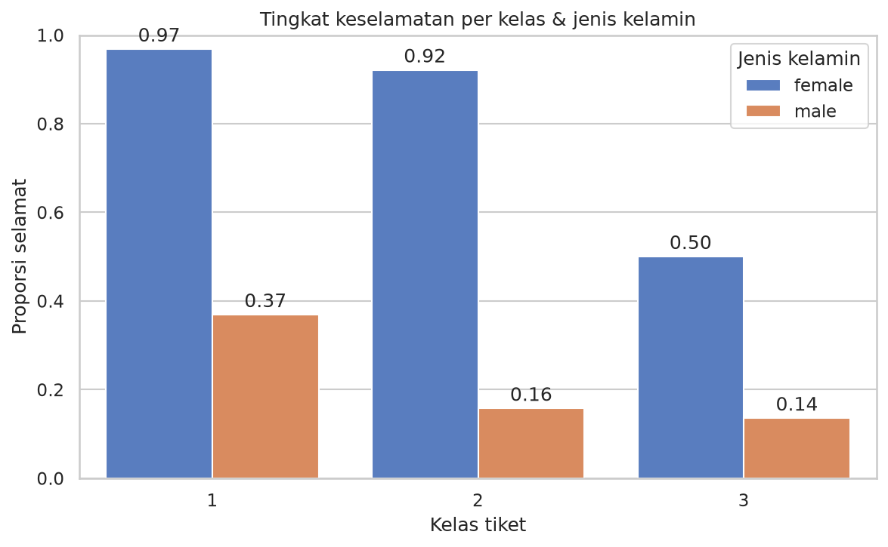
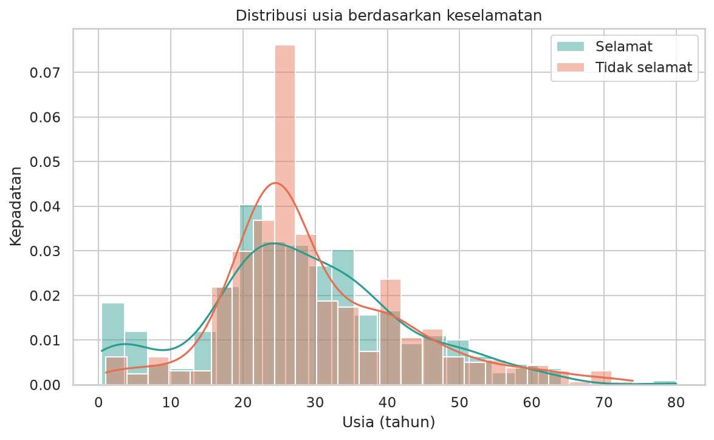
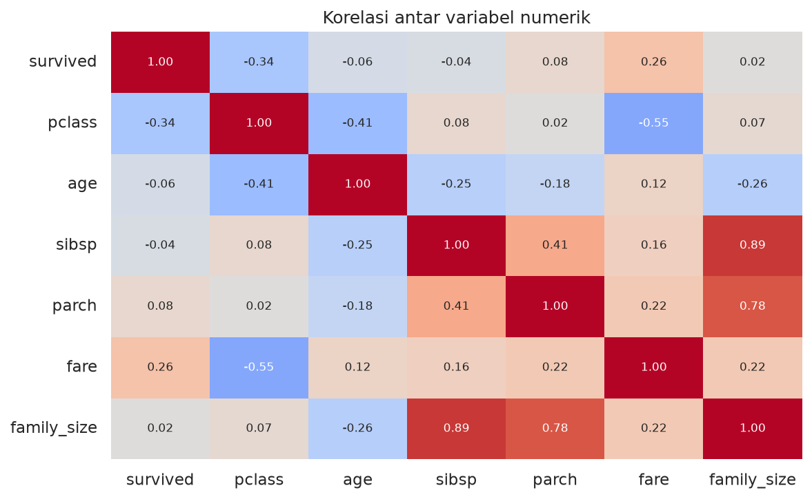
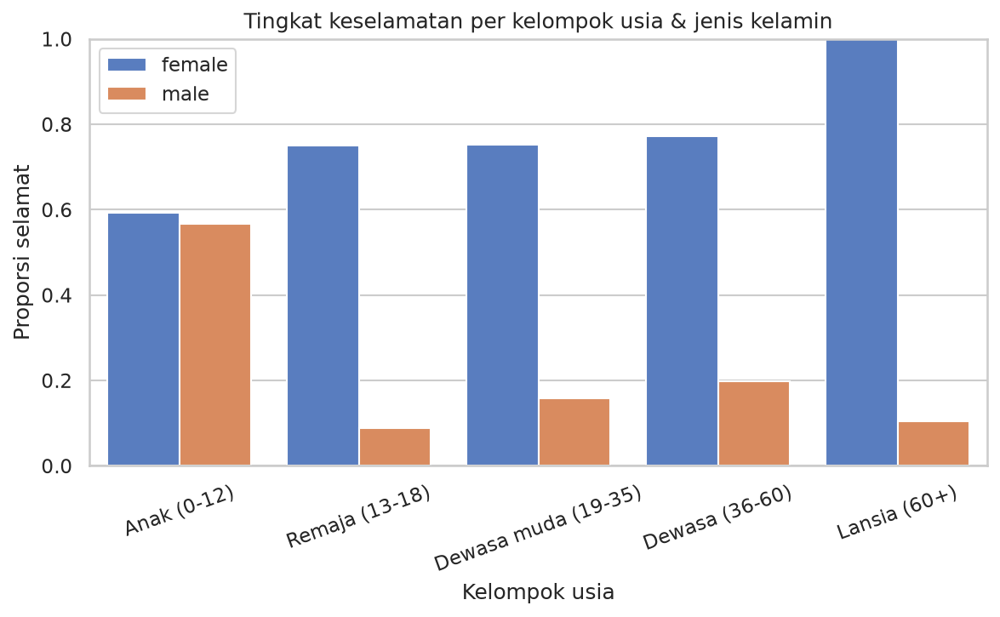

# Dokumentasi Capstone Project

## 1. Judul dan Identitas
- Judul: Analisis Faktor Keselamatan Penumpang Titanic
- Nama: Contoh pengerjaan lengkap (Capstone Python Intensive Bootcamp)
- Opsi: A (Dataset Publik) + stretch goals (uji statistik, dashboard 2x3, Excel multi-sheet)
- Tanggal: 2026-10-01

## 2. Latar Belakang / Masalah
Tenggelamnya Titanic (1912) adalah dataset klasik untuk latihan EDA. Pertanyaan utama:
- Faktor apa (jenis kelamin, kelas tiket, usia, ukuran keluarga, harga tiket) yang paling berkaitan dengan keselamatan?
- Apakah faktor-faktor itu berdiri sendiri atau saling memperkuat?

## 3. Sumber Data
- Dataset: Titanic (seaborn-data), 891 baris x 15 kolom.
- Variabel penting: survived, pclass, sex, age, sibsp, parch, fare, embarked, deck.
- Data bermasalah: age kosong 177 (19,9%), deck kosong 688 (77,2%), embarked/embark_town kosong 2; 107 baris identik penuh.

## 4. Metodologi / Alur Kerja
1. Load data dan inspeksi awal (shape, dtypes, missing, duplikat).
2. Cleaning: age diisi median per (pclass, sex) + kolom penanda `age_imputed`; embarked diisi modus; deck kosong menjadi kategori "Unknown"; kolom redundan `alive` dan `class` dihapus; teks diubah ke `category`.
   - **Keputusan duplikat:** 107 baris identik **tidak dihapus** karena tidak ada ID penumpang, sehingga baris identik bisa jadi orang berbeda.
3. Feature engineering: `family_size`, `age_group`, `fare_quartile`, `status`.
4. Analisis: groupby, pivot table sex x kelas, korelasi, uji chi-square dan Mann-Whitney.
5. Visualisasi: 6 grafik + dashboard 2x3.
6. Penarikan insight (dihitung otomatis di `tulis_insight()`) dan export (CSV, Excel).

## 5. Hasil dan Visualisasi
| Grafik | Penjelasan |
|---|---|
|  | Perempuan selamat jauh lebih sering di semua kelas; selisih terbesar di kelas 2. |
|  | Anak kecil (usia < 10) lebih banyak yang selamat; puncak usia 20–30 didominasi yang tidak selamat. |
|  | Fare turun tajam dari kelas 1 ke 3 (skala log) dengan banyak outlier. |
|  | pclass (-0,34) dan fare (+0,26) adalah korelasi numerik terkuat dengan survived. |
|  | Keluarga 2–4 orang lebih sering selamat; keluarga besar dan penumpang sendirian lebih rendah. |
|  | Pola perempuan > laki-laki konsisten di semua kelompok usia kecuali anak-anak (hampir setara). |

Dashboard lengkap: `output/figures/00_dashboard.png` (juga PDF).

## 6. Insight dan Temuan
1. **Jenis kelamin adalah pembeda terkuat.** 74.2% penumpang perempuan selamat, dibanding 18.9% laki-laki (selisih 55 poin persentase; chi-square p = 1.2e-58).

2. **Kelas tiket memengaruhi peluang selamat.** Kelas 1: 63.0%, kelas 2: 47.3%, kelas 3: 24.2% (chi-square p = 4.5e-23). Korelasi pclass dengan survived = -0.34.

3. **Efek kelas dan jenis kelamin saling menguatkan.** Perempuan kelas 1 selamat 96.8%, sedangkan laki-laki kelas 3 hanya 13.5%. Namun perempuan kelas 3 (50.0%) masih lebih baik daripada laki-laki kelas 1 (36.9%).

4. **Anak-anak diprioritaskan.** Kelompok usia 0-12 tahun selamat 58.0% (n=69), lebih tinggi daripada dewasa muda 19-35 tahun (35.8%) dan lansia 60+ (22.7%).

5. **Ukuran keluarga berhubungan non-linier dengan keselamatan.** Penumpang sendirian selamat 30.4%, keluarga 2-4 orang 57.9%, dan keluarga >= 5 orang hanya 16.1% (n=62).

6. **Harga tiket berkorelasi positif dengan keselamatan.** Median fare kelas 1 = 60.3 vs kelas 3 = 8.1; penumpang yang selamat membayar lebih mahal (Mann-Whitney p = 4.6e-22; korelasi fare-survived = 0.26).

## 7. Kesimpulan
Jenis kelamin dan kelas tiket adalah dua faktor terkuat dan saling memperkuat: perempuan kelas 1 hampir pasti selamat (96,8%), laki-laki kelas 3 hampir tidak (13,5%). Anak-anak juga diprioritaskan. Ukuran keluarga dan harga tiket memberi gambaran tambahan; harga tiket sendiri berkorelasi kuat dengan kelas (pclass-fare = -0,55), sehingga efeknya tidak sepenuhnya independen dari kelas. Seluruh hasil bersifat asosiasi pada data observasional, bukan bukti sebab-akibat.

## 8. Pengembangan Selanjutnya
- Model logistic regression / decision tree untuk memprediksi keselamatan.
- Mengisi usia dengan gelar penumpang agar imputasi lebih akurat.
- Memeriksa interaksi usia x kelas dengan visualisasi tambahan.
