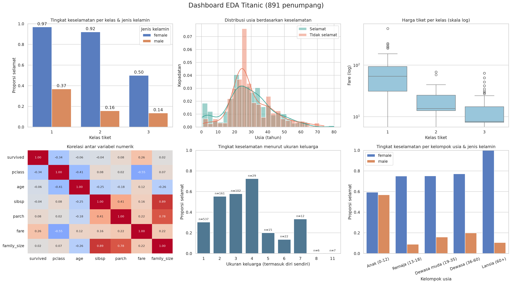

# Capstone Project: Analisis Dataset Titanic (EDA Lengkap)

## Nama
Capstone Python Intensive Bootcamp — contoh pengerjaan lengkap

## Opsi Project
Opsi A — Analisis Dataset Publik (Level Menengah), dengan ketiga stretch goal.

## Deskripsi Singkat
EDA lengkap pada dataset publik Titanic (891 penumpang): inspeksi, cleaning, feature engineering, groupby/pivot/korelasi, uji statistik, 6 visualisasi + dashboard 2x3, dan 6 insight yang dihitung langsung dari data.

## Sumber Data
- Dataset Titanic dari repositori [seaborn-data](https://github.com/mwaskom/seaborn-data) (`titanic.csv`), salinan lokal di `data/raw/titanic.csv`.
- Jika file lokal tidak ada, `src/main.py` mengunduhnya otomatis dari URL di atas.

## Cara Menjalankan
```bash
pip install -r requirements.txt
python src/main.py
```

Seluruh output dibuat otomatis (lihat bagian Struktur Folder). Log eksekusi: `output/reports/run_log.txt`.

## Hasil Utama / Insight
1. **Jenis kelamin adalah pembeda terkuat.** 74.2% penumpang perempuan selamat, dibanding 18.9% laki-laki (selisih 55 poin persentase; chi-square p = 1.2e-58).

2. **Kelas tiket memengaruhi peluang selamat.** Kelas 1: 63.0%, kelas 2: 47.3%, kelas 3: 24.2% (chi-square p = 4.5e-23). Korelasi pclass dengan survived = -0.34.

3. **Efek kelas dan jenis kelamin saling menguatkan.** Perempuan kelas 1 selamat 96.8%, sedangkan laki-laki kelas 3 hanya 13.5%. Namun perempuan kelas 3 (50.0%) masih lebih baik daripada laki-laki kelas 1 (36.9%).

4. **Anak-anak diprioritaskan.** Kelompok usia 0-12 tahun selamat 58.0% (n=69), lebih tinggi daripada dewasa muda 19-35 tahun (35.8%) dan lansia 60+ (22.7%).

5. **Ukuran keluarga berhubungan non-linier dengan keselamatan.** Penumpang sendirian selamat 30.4%, keluarga 2-4 orang 57.9%, dan keluarga >= 5 orang hanya 16.1% (n=62).

6. **Harga tiket berkorelasi positif dengan keselamatan.** Median fare kelas 1 = 60.3 vs kelas 3 = 8.1; penumpang yang selamat membayar lebih mahal (Mann-Whitney p = 4.6e-22; korelasi fare-survived = 0.26).



## Struktur Folder
```text
opsi_a_titanic_eda/
├── data/
│   ├── raw/titanic.csv                 # data asli
│   └── processed/titanic_clean.csv     # data setelah cleaning + fitur baru
├── src/main.py                         # seluruh pipeline (function per tahap)
├── output/
│   ├── figures/                        # 6 grafik PNG + dashboard PNG/PDF
│   └── reports/                        # CSV ringkasan, Excel multi-sheet, insights.md, run_log.txt
├── requirements.txt
├── DOCUMENTATION.md                    # dokumentasi capstone (template Bagian 7)
└── README.md
```

## Pengembangan Selanjutnya (opsional)
- Model prediksi sederhana (logistic regression) untuk memperkirakan peluang selamat.
- Ekstrak gelar (Mr/Mrs/Miss) dari nama untuk imputasi usia yang lebih baik (kolom nama tidak ada di versi seaborn).
