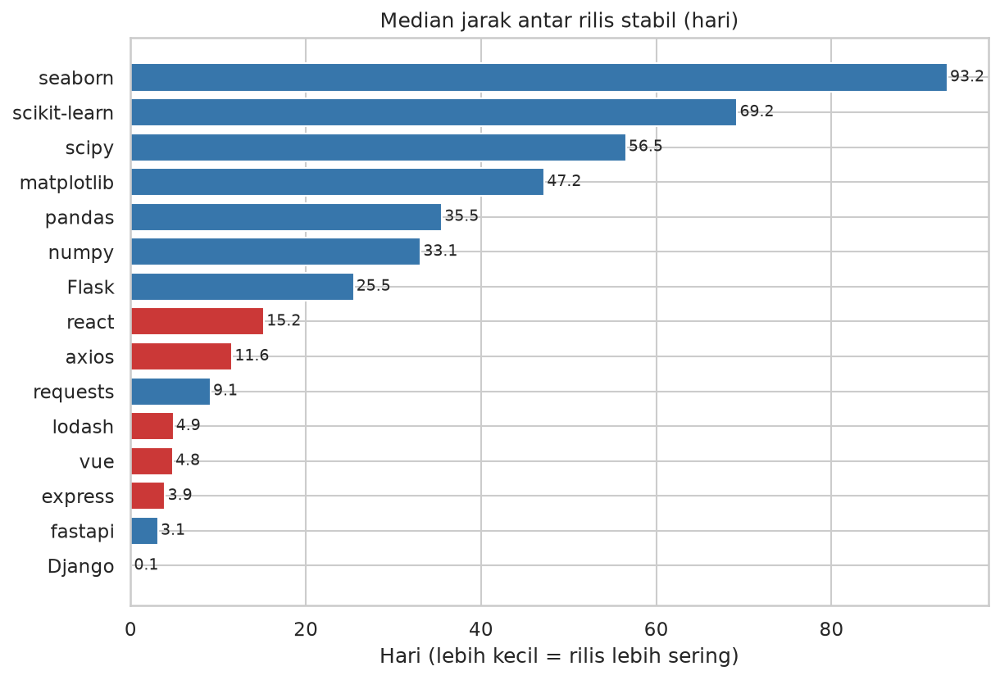
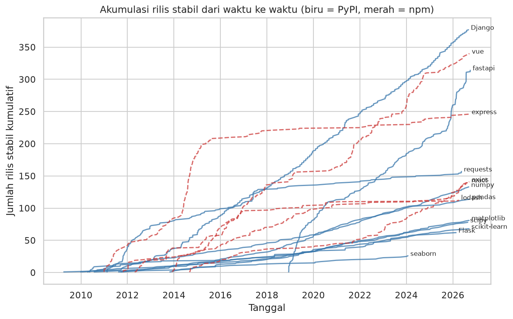
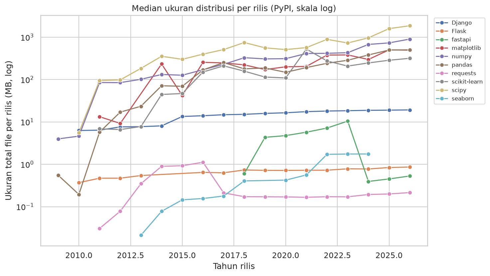

# Dokumentasi Capstone Project

## 1. Judul dan Identitas
- Judul: Ritme Rilis Library Populer — PyPI vs npm
- Nama: Contoh pengerjaan lengkap (Capstone Python Intensive Bootcamp)
- Opsi: B (Pipeline dari API) + stretch goals
- Tanggal data: 2026-10-01

## 2. Latar Belakang / Masalah
Seberapa sering library populer merilis versi baru, dan apakah ritmenya berbeda antar library dan antar ekosistem (Python vs JavaScript)? Pertanyaan turunan:
- Library mana yang paling aktif dirilis per tahun (bukan sekadar total sepanjang masa)?
- Seberapa besar pengaruh pre-release dan build otomatis terhadap angka rilis?
- Bagaimana tren rilis dari tahun ke tahun?

## 3. Sumber Data
- PyPI JSON API (10 paket) dan npm registry (5 paket), diambil langsung via `requests`.
- Mentah: 5.703 baris rilis (15 paket). Setelah cleaning: 5.697 baris; 2.390 rilis stabil dipakai untuk analisis irama.
- Variabel: paket, ekosistem, versi, waktu rilis, jumlah file dan ukuran (PyPI), status yanked, status pre-release.

## 4. Metodologi / Alur Kerja
1. **Ambil data** — `ambil_json()` generik: cache segar → API (3x percobaan, backoff, timeout) → cache lama → `None`. Hanya field yang diperlukan disimpan sebagai cache (respons npm penuh bisa >7 MB).
2. **Gabungkan** dua sumber ke satu DataFrame (`buat_dataframe`).
3. **Cleaning** — parsing waktu UTC; buang baris tanpa tanggal valid (6) dan duplikat (0); tandai pre-release (aturan versi PEP 440 untuk PyPI, tanda `-` untuk semver npm) dan versi yanked (9). Analisis irama hanya memakai rilis stabil non-yanked.
4. **Analisis** — jumlah rilis, median/P90 jarak antar rilis, rilis per tahun (dinormalisasi umur paket), pivot paket×tahun, perbandingan ekosistem, tren ukuran distribusi PyPI.
5. **Visualisasi** — 5 grafik.
6. **Insight + simpan** — data mentah/bersih, ringkasan CSV, Excel multi-sheet, `insights.md` (angka dihitung otomatis).

Penanganan error: retry dan fallback cache untuk API, `SystemExit` jelas jika tidak ada data sama sekali, paket gagal dilewati tanpa menghentikan pipeline.

## 5. Hasil dan Visualisasi
| Grafik | Penjelasan |
|---|---|
|  | Django (377) dan vue (340) punya rilis stabil terbanyak; seaborn paling sedikit (26). |
|  | Median jarak antar rilis berkisar dari hitungan jam (Django) hingga ±93 hari (seaborn). |
|  | Lonjakan khas: express (100 rilis di 2014), fastapi sejak 2019, dan penurunan lodash/requests. |
|  | Kurva kumulatif memperlihatkan fastapi dan Django naik paling curam; seaborn hampir datar. |
|  | Ukuran total file per rilis membesar karena makin banyak wheel per platform. |

## 6. Insight dan Temuan
1. **Django punya rilis stabil terbanyak (377), tetapi fastapi paling aktif per tahun** (40.2 rilis/tahun) sedangkan seaborn paling jarang (2.0/tahun). Jumlah total dipengaruhi umur paket, sehingga rilis per tahun lebih adil untuk membandingkan.

2. **Jarak antar rilis sangat bervariasi.** Median tercepat: Django (0.1 hari), terlama: seaborn (93.2 hari). Untuk Django, 52% interval antar rilis kurang dari 1 hari karena beberapa cabang dukungan dirilis bersamaan (rilis keamanan), sehingga mediannya mendekati nol. Pandas memiliki 114 rilis stabil dengan median 35.5 hari.

3. **Perbandingan ekosistem:** median rilis per paket per tahun di PyPI = 6.1 vs npm = 11.7; median jarak antar rilis PyPI = 18.4 hari vs npm = 5.8 hari (sampel hanya 10 paket PyPI dan 5 paket npm, jadi bukan generalisasi ekosistem).

4. **Tahun 2014 adalah tahun dengan rilis stabil terbanyak** (203 rilis dari seluruh paket yang dipantau; express sendiri menyumbang 100); pada tahun penuh terakhir (2025) total rilis = 172.

5. **Proporsi pre-release berbeda jauh:** PyPI 9.0% vs npm 76.3% dari seluruh versi terdaftar. Angka npm didominasi react: 95% versinya pre-release (2819 versi, 70% di antaranya build canary/experimental/nightly/dev).

6. **Paket dengan rilis terakhir paling lama:** seaborn (979 hari sebelum tanggal pengambilan data), sedangkan paling baru: fastapi (0 hari).

7. **Ukuran distribusi NumPy** (median per rilis) berubah dari 126.60 MB (2015) menjadi 901.74 MB (2026); median jumlah file per rilis naik dari 13 menjadi 72 (makin banyak wheel per platform/versi Python).

## 7. Kesimpulan
Ritme rilis sangat bergantung pada gaya pengelolaan proyek: fastapi dan vue dirilis sangat sering, library ilmiah (numpy, pandas, scipy) stabil dengan rilis tiap beberapa minggu, sedangkan seaborn jarang. Di sampel ini npm lebih sering merilis daripada PyPI, tetapi dengan hanya 15 paket kesimpulan itu tidak boleh digeneralisasi. Menghitung "rilis per tahun" dan memisahkan pre-release/build otomatis mengubah gambaran secara signifikan.

## 8. Pengembangan Selanjutnya
- Menambahkan data unduhan untuk menghubungkan popularitas dengan ritme rilis.
- Menambah paket/ekosistem dan membandingkan rilis mayor vs minor vs patch.
- Menjadwalkan pengambilan data berkala dan menyimpan histori.
