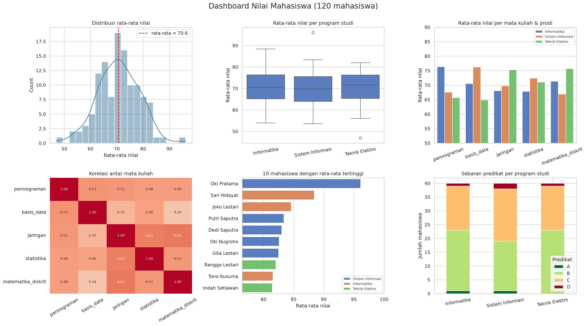

# Capstone Project: Aplikasi Analisis Nilai Akademik (OOP)

## Nama
Capstone Python Intensive Bootcamp — contoh pengerjaan lengkap

## Opsi Project
Opsi C — Mini Aplikasi Analisis Nilai / Akademik (Level Tinggi), dengan ketiga stretch goal: perbandingan dua prodi, mode interaktif terminal, dan simpan/muat state.

## Deskripsi Singkat
Aplikasi berbasis kelas `AnalisisNilai` (OOP + Pandas) untuk mengelola data nilai 120 mahasiswa pada 3 program studi dan 5 mata kuliah: tambah data dengan validasi, statistik, filter, ranking, uji perbandingan prodi, 6 visualisasi + dashboard, export CSV/Excel, dan penyimpanan state. Dilengkapi 7 unit test.

## Sumber Data
- **Data sintetis (fiktif)** buatan sendiri dengan `src/generate_data.py` (seed tetap = 2026, reproducible). Setiap prodi diberi "bonus" kemampuan pada mata kuliah tertentu sehingga ada pola yang dapat dianalisis. Nama dan nilai bukan data nyata.
- File: `data/raw/nilai_mahasiswa.csv`.

## Cara Menjalankan
```bash
pip install -r requirements.txt
python src/generate_data.py            # (opsional) buat ulang data sintetis
python src/main.py                     # pipeline otomatis: semua fitur + output
python src/main.py --interaktif        # mode menu terminal
python -m unittest discover -s tests -v   # unit test
```

Log eksekusi tersimpan di `output/reports/`: `run_log.txt` (pipeline), `demo_interaktif_log.txt` (mode interaktif dengan input dari `data/demo_input.txt`), `test_log.txt` (unit test).

## Hasil Utama / Insight
1. **Program studi dengan rata-rata tertinggi: Informatika** (70.84); selisih rata-rata antar prodi hanya 0.33 poin, sehingga perbedaan lebih terlihat pada mata kuliah daripada rata-rata keseluruhan.

2. **Setiap prodi unggul pada mata kuliah berbeda:** Informatika → pemrograman; Sistem Informasi → basis_data; Teknik Elektro → matematika_diskrit.

3. **Perbandingan Informatika vs Teknik Elektro (Welch t-test, alpha 5%):** mata kuliah dengan beda signifikan: pemrograman, basis_data, jaringan. Selisih terbesar pada pemrograman (+10.7 poin).

4. **Semua korelasi antar mata kuliah positif** (r antara 0.26 dan 0.65): terkuat jaringan–matematika_diskrit, terlemah basis_data–matematika_diskrit; mahasiswa yang kuat di satu mata kuliah cenderung kuat di lainnya (kemampuan umum).

5. **Mata kuliah paling bervariasi: pemrograman** (SD 11.7); paling seragam: jaringan (SD 9.3).

6. **Sebaran predikat:** A 1.7%, B 52.5%, C 42.5%, D 3.3%.



## Struktur Folder
```text
opsi_c_analisis_nilai_oop/
├── data/
│   ├── raw/nilai_mahasiswa.csv             # data sintetis
│   ├── processed/                          # data + rata_rata, state_aplikasi.json
│   └── demo_input.txt                      # skrip input untuk demo mode interaktif
├── src/
│   ├── analisis_nilai.py                   # kelas AnalisisNilai
│   ├── generate_data.py                    # pembuat data sintetis
│   └── main.py                             # pipeline + mode interaktif
├── tests/test_analisis_nilai.py            # 7 unit test
├── output/
│   ├── figures/                            # 6 grafik + dashboard
│   └── reports/                            # CSV/Excel, perbandingan prodi, insights, log
├── requirements.txt
├── DOCUMENTATION.md
└── README.md
```

## Pengembangan Selanjutnya (opsional)
- Data per semester dan perhitungan IPK berbobot SKS.
- Antarmuka web sederhana (mis. Streamlit) di atas kelas yang sama.
- Deteksi mahasiswa berisiko (nilai turun/di bawah ambang).
