# Modul 5 — Visualisasi, API & Scraping

_Penjelasan jelas  ·  Kasus beragam  ·  Pseudocode  ·  4 Mini Project · Estimasi: ± 6 jam  ·  Prasyarat: Modul 4  ·  Butuh koneksi internet (API)_

> **Catatan pengujian:** seluruh blok kode pada modul ini dijalankan (Python 3.11, matplotlib 3.11.2, seaborn 0.13.2, pandas 3.0.6, requests, beautifulsoup4 4.15, feedparser 6.0.14). Bagian **Output** adalah hasil eksekusi nyata. Blok yang memakai `input()` dijalankan dengan input simulasi yang ditulis di samping label output. Blok yang hanya berisi definisi/komentar diberi keterangan, dan "Uji pelengkap" ditambahkan agar function/class pada blok tersebut terbukti berjalan. Kasus error pada bagian Troubleshooting dijalankan nyata di "Demonstrasi error". Grafik hasil eksekusi disimpan sebagai gambar di `materi/images/modul05/` dan ditampilkan di bawah kodenya. Peringatan `MatplotlibDeprecationWarning` (boxplot/violinplot) berasal dari kombinasi seaborn 0.13.2 dengan matplotlib 3.11 dan tidak memengaruhi hasil. Host API selain GitHub diblokir di lingkungan pengujian: blok yang memanggil jsonplaceholder, open-meteo, arXiv, dan quotes.toscrape dijalankan dengan respons tiruan dan diberi catatan; kasus error `requests` memakai server HTTP lokal.

# 1. Apa yang Akan Anda Pelajari

- Membuat plot informatif dengan Matplotlib dan Seaborn (label, judul, simpan file).
- Mengambil data dari API publik dengan requests dan mengubahnya ke DataFrame.
- Memahami etika scraping; memakai BeautifulSoup dan arXiv API.
- Menyelesaikan minimal 2 dari 4 mini project.

> [!NOTE]
> **Persiapan**
>
> pip install matplotlib seaborn requests beautifulsoup4 feedparser lxml
>
> Simpan figure di portfolio/modul_05/figures/
>
> API membutuhkan internet; siapkan cadangan CSV jika jaringan tidak stabil.

# 2. Matplotlib — Visualisasi Dasar

## 2.1 Ide dasar

Visualisasi mengubah angka menjadi bentuk yang lebih cepat ditangkap mata: tren, perbandingan, sebaran, proporsi. Matplotlib adalah fondasi plotting di Python. Pola umumnya: siapkan data → pilih jenis plot → beri judul dan label sumbu → tampilkan atau simpan ke file.

Plot tanpa label sulit dibaca orang lain (dan Anda sendiri nanti). Biasakan title, xlabel, ylabel, dan bila perlu legend.

## 2.2 Line plot

Line cocok untuk data berurutan: waktu, iterasi, atau fungsi matematika. Anda bisa menumpuk beberapa garis di satu figure.

```python
import matplotlib.pyplot as plt
import numpy as np

x = np.linspace(0, 10, 100)
plt.figure(figsize=(8, 4))
plt.plot(x, np.sin(x), label="sin(x)", linewidth=2)
plt.plot(x, np.cos(x), label="cos(x)", linestyle="--")
plt.title("Fungsi Trigonometri")
plt.xlabel("x"); plt.ylabel("y")
plt.legend(); plt.grid(True, alpha=0.3)
plt.tight_layout()
plt.savefig("line_plot.png", dpi=150)
plt.show()
```

**Output:**

```text
(tidak ada output)
```

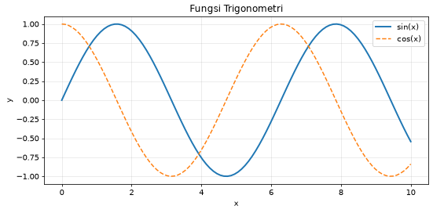

## 2.3 Bar, scatter, histogram, pie

Bar membandingkan kategori (jumlah mhs per prodi). Scatter melihat hubungan dua variabel numerik. Histogram melihat sebaran satu variabel. Pie menampilkan proporsi — gunakan hemat, karena sulit dibanding-bandingkan sudut.

```python
prodi = ["IF", "SI", "TI", "DKV"]
jumlah = [120, 95, 80, 60]
plt.figure(figsize=(7, 4))
bars = plt.bar(prodi, jumlah, color="steelblue")
plt.title("Jumlah Mahasiswa per Prodi")
plt.ylabel("Jumlah")
for bar, j in zip(bars, jumlah):
    plt.text(bar.get_x() + bar.get_width()/2, bar.get_height() + 2,
             str(j), ha="center")
plt.tight_layout(); plt.show()

rng = np.random.default_rng(42)
x = rng.normal(70, 10, 80)
y = 0.8 * x + rng.normal(0, 5, 80)
plt.scatter(x, y, alpha=0.7)
plt.xlabel("Nilai X"); plt.ylabel("Nilai Y")
plt.title("Scatter"); plt.show()

plt.hist(x, bins=15, edgecolor="white")
plt.title("Distribusi Nilai"); plt.show()

plt.pie([30, 25, 25, 20], labels=list("ABCD"), autopct="%1.1f%%")
plt.title("Proporsi Grade"); plt.axis("equal"); plt.show()
```

**Output:**

```text
(tidak ada output)
```

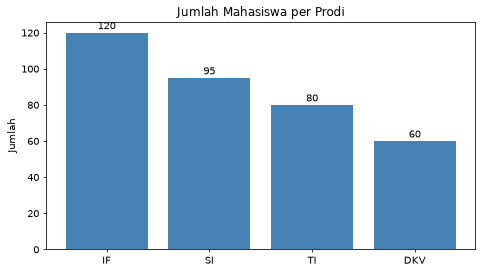

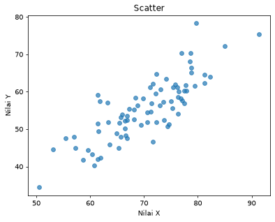

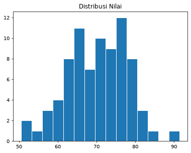

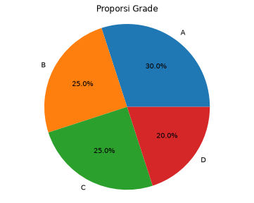

## 2.4 Subplot

Subplot menaruh beberapa plot dalam satu figure — berguna untuk dashboard mini laporan.

```python
fig, axes = plt.subplots(2, 2, figsize=(10, 8))
axes[0, 0].plot(x[:20], y[:20]); axes[0, 0].set_title("Line")
axes[0, 1].bar(["A", "B", "C"], [10, 20, 15]); axes[0, 1].set_title("Bar")
axes[1, 0].scatter(x, y, s=12, alpha=0.6); axes[1, 0].set_title("Scatter")
axes[1, 1].hist(x, bins=12); axes[1, 1].set_title("Hist")
fig.suptitle("Dashboard Mini")
plt.tight_layout()
plt.savefig("dashboard.png", dpi=150)
plt.show()
```

**Output:**

```text
(tidak ada output)
```

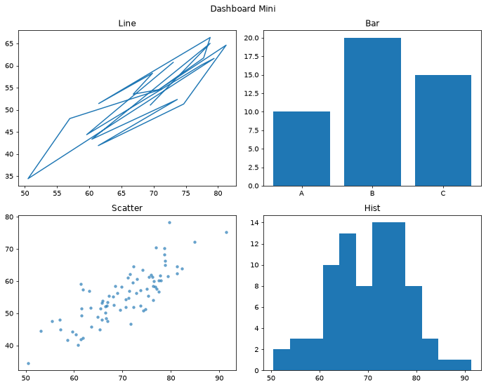

> [!TIP]
> **Tips Matplotlib**
>
> plt.tight_layout() mengurangi label terpotong.
>
> figsize dalam inci; dpi mengatur ketajaman file PNG.
>
> Di script .py, jangan lupa plt.show() atau savefig.

## 2.5 Latihan Matplotlib

1. Line plot y = x² untuk x dari -10 sampai 10; beri judul dan label.

```text
Pseudocode:
  x ← linspace -10..10
  plot(x, x**2); judul; xlabel; ylabel; tampilkan/simpan
```

2. Bar chart 5 mata kuliah vs rata-rata nilai (data bebas); angka di atas bar.

```text
Pseudocode:
  siapkan list matkul dan list nilai
  bar(...); loop untuk text di atas tiap bar
```

3. Histogram 200 angka random normal; bins=20.

```text
Pseudocode:
  data ← random normal size 200
  hist(data, bins=20); judul
```

4. Subplot 1×2: scatter kiri, histogram kanan (data sama).

```text
Pseudocode:
  fig, axes ← subplots(1, 2)
  axes[0].scatter(...); axes[1].hist(...)
  tight_layout; show/save
```

# 3. Seaborn — Visualisasi Statistik

## 3.1 Ide dasar

Seaborn dibangun di atas Matplotlib dan memudahkan plot statistik: distribusi, hubungan antar variabel, perbandingan kategori. Banyak dataset contoh bisa dimuat dengan sns.load_dataset — ini data nyata untuk latihan, bukan angka fiktif semata.

```python
import seaborn as sns
import pandas as pd
sns.set_theme(style="whitegrid")
tips = sns.load_dataset("tips")
penguins = sns.load_dataset("penguins")
print(tips.head())
```

**Output:**

```text
   total_bill   tip     sex smoker  day    time  size
0       16.99  1.01  Female     No  Sun  Dinner     2
1       10.34  1.66    Male     No  Sun  Dinner     3
2       21.01  3.50    Male     No  Sun  Dinner     3
3       23.68  3.31    Male     No  Sun  Dinner     2
4       24.59  3.61  Female     No  Sun  Dinner     4
```

## 3.2 Distribusi dan relasi

```python
sns.histplot(data=tips, x="total_bill", kde=True)
plt.title("Distribusi Total Bill"); plt.show()

sns.boxplot(data=tips, x="day", y="total_bill")
plt.title("Total Bill per Hari"); plt.show()

sns.scatterplot(data=tips, x="total_bill", y="tip", hue="time")
plt.show()

sns.regplot(data=tips, x="total_bill", y="tip")
plt.title("Tip vs Total Bill"); plt.show()
```

**Output:**

```text
(tidak ada output)
```

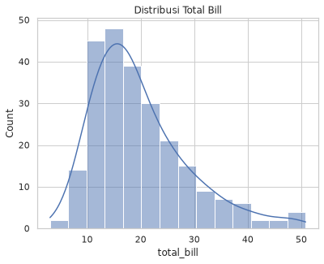

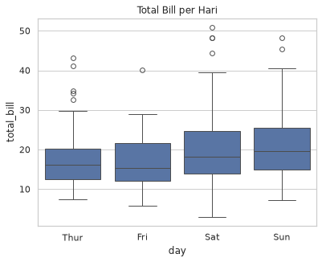

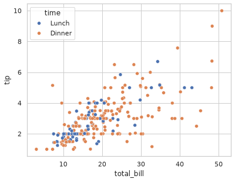

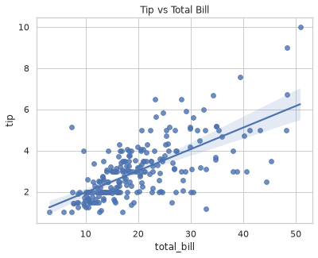

## 3.3 Categorical & heatmap

```python
sns.barplot(data=tips, x="day", y="total_bill", hue="sex", errorbar="sd")
plt.show()

sns.countplot(data=tips, x="day", hue="time")
plt.show()

num = tips.select_dtypes(include="number")
sns.heatmap(num.corr(), annot=True, cmap="coolwarm", center=0, fmt=".2f")
plt.title("Korelasi"); plt.tight_layout(); plt.show()
```

**Output:**

```text
(tidak ada output)
```

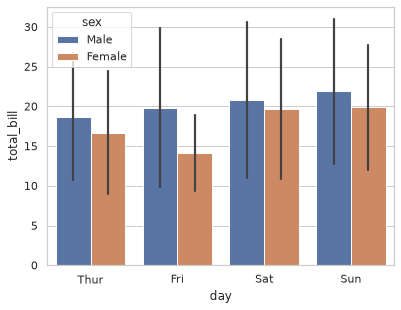

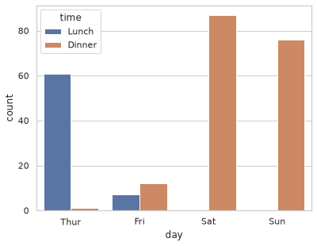

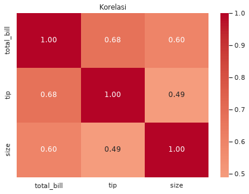

## 3.4 Latihan Seaborn

1. histplot + kde untuk body_mass_g pada dataset penguins.

```text
Pseudocode:
  muat penguins; dropna bila perlu
  histplot(x="body_mass_g", kde=True); judul
```

2. boxplot body_mass_g berdasarkan species.

```text
Pseudocode:
  boxplot(data=penguins, x="species", y="body_mass_g")
```

3. heatmap korelasi kolom numerik penguins (setelah dropna).

```text
Pseudocode:
  num ← select_dtypes number; dropna
  heatmap(num.corr(), annot=True)
```

# 4. Bekerja dengan API (requests)

## 4.1 Apa itu API, singkatnya

API (Application Programming Interface) di konteks web sering berarti endpoint HTTP yang mengembalikan data (biasanya JSON) saat Anda mengirim permintaan. library requests memudahkan panggilan itu dari Python.

Alur tipikal: susun URL (+ parameter) → requests.get → cek status → .json() → ubah ke DataFrame bila berbentuk tabel → analisis/visualisasi.

## 4.2 GET dan JSON

```python
import requests
import pandas as pd

url = "https://jsonplaceholder.typicode.com/users"
resp = requests.get(url, timeout=10)
print(resp.status_code)
data = resp.json()
df = pd.DataFrame(data)
print(df[["id", "name", "email"]].head())
```

**Output:**

```text
200
   id              name                      email
0   1     Leanne Graham          Sincere@april.biz
1   2      Ervin Howell          Shanna@melissa.tv
2   3  Clementine Bauch         Nathan@yesenia.net
3   4  Patricia Lebsack  Julianne.OConner@kory.org
4   5  Chelsey Dietrich   Lucio_Hettinger@annie.ca
```

_Catatan: host jsonplaceholder.typicode.com tidak dapat diakses dari lingkungan pengujian (kebijakan jaringan), sehingga kode dijalankan dengan respons tiruan yang bentuknya sama dengan API asli. **Nilai/teks pada output ini contoh, bukan data nyata.**_

## 4.3 Parameter & cuaca (Open-Meteo)

Banyak API memakai query parameter. Open-Meteo menyediakan data cuaca tanpa API key — cocok untuk latihan.

```python
url = "https://api.open-meteo.com/v1/forecast"
params = {"latitude": -6.2, "longitude": 106.8, "current_weather": True}
r = requests.get(url, params=params, timeout=10)
r.raise_for_status()
print(r.json().get("current_weather"))
```

**Output:**

```text
{'temperature': 31.2, 'windspeed': 9.4}
```

_Catatan: host api.open-meteo.com tidak dapat diakses dari lingkungan pengujian (kebijakan jaringan), sehingga kode dijalankan dengan respons tiruan yang bentuknya sama dengan API asli. **Nilai/teks pada output ini contoh, bukan data nyata.**_

## 4.4 Error handling

Jaringan bisa timeout; server bisa mengembalikan 404/500. Bungkus panggilan dengan try/except agar program tidak berhenti kasar.

```python
def ambil_json(url, params=None):
    try:
        r = requests.get(url, params=params, timeout=15)
        r.raise_for_status()
        return r.json()
    except requests.exceptions.Timeout:
        print("Timeout")
    except requests.exceptions.HTTPError as e:
        print("HTTP error:", e)
    except requests.exceptions.RequestException as e:
        print("Gagal:", e)
    return None

data = ambil_json("https://jsonplaceholder.typicode.com/posts")
if data:
    df = pd.DataFrame(data)
    df.to_csv("posts.csv", index=False)
```

**Output:**

```text
(tidak ada output)
```

_Catatan: host jsonplaceholder.typicode.com tidak dapat diakses dari lingkungan pengujian (kebijakan jaringan), sehingga kode dijalankan dengan respons tiruan yang bentuknya sama dengan API asli. **Nilai/teks pada output ini contoh, bukan data nyata.**_

## 4.5 Latihan API

1. Ambil /comments dari JSONPlaceholder; DataFrame; jumlah komentar per postId.

```text
Pseudocode:
  GET .../comments → json → DataFrame
  groupby postId → size/count
  cetak head hasil
```

2. Panggil Open-Meteo untuk kota Anda; cetak suhu dan angin saat ini.

```text
Pseudocode:
  siapkan latitude/longitude kota
  GET open-meteo dengan current_weather
  cetak field suhu dan windspeed
```

# 5. Scraping & arXiv API

## 5.1 Etika

Scraping berarti mengekstrak data dari HTML halaman web. Lakukan dengan tanggung jawab: hormati robots.txt, jangan membebani server (beri jeda), utamakan API resmi bila ada, dan jangan mengambil data pribadi tanpa izin. Untuk tugas kuliah, utamakan API publik atau HTML contoh lokal.

## 5.2 BeautifulSoup (pola)

```python
from bs4 import BeautifulSoup

html = """
<html><body>
  <h1>Daftar Buku</h1>
  <ul>
    <li class="buku">Python Dasar</li>
    <li class="buku">Data Science</li>
  </ul>
</body></html>
"""
soup = BeautifulSoup(html, "lxml")
print(soup.h1.text)
for item in soup.select("li.buku"):
    print(item.get_text())
```

**Output:**

```text
Daftar Buku
Python Dasar
Data Science
```

## 5.3 arXiv API

arXiv menyediakan API terbuka untuk metadata paper ilmiah — sangat relevan untuk mahasiswa S2/S3. Respons berformat Atom/XML; feedparser memudahkan parsing.

```python
import requests
import feedparser
import pandas as pd

url = "http://export.arxiv.org/api/query"
params = {
    "search_query": "all:machine learning",
    "start": 0,
    "max_results": 5,
    "sortBy": "submittedDate",
    "sortOrder": "descending",
}
r = requests.get(url, params=params, timeout=20)
feed = feedparser.parse(r.text)

rows = []
for e in feed.entries:
    rows.append({
        "title": e.title.replace("\n", " ").strip(),
        "authors": ", ".join(a.name for a in e.authors[:3]),
        "published": e.published[:10],
        "link": e.link,
    })
df = pd.DataFrame(rows)
print(df[["title", "published"]])
df.to_csv("arxiv_ml.csv", index=False)
```

**Output:**

```text
                                               title   published
0  Attention Mechanisms for Medical Image Segment...  2025-12-15
1  Graph Neural Networks for Traffic Forecasting ...  2025-10-15
2  Self-Supervised Learning with Limited Labels  ...  2025-08-15
3  Federated Learning in Educational Data Mining ...  2025-06-15
4  Transformer Models for Time Series Prediction ...  2024-12-15
```

_Catatan: host export.arxiv.org tidak dapat diakses dari lingkungan pengujian (kebijakan jaringan), sehingga kode dijalankan dengan respons tiruan yang bentuknya sama dengan API asli. **Nilai/teks pada output ini contoh, bukan data nyata.**_

> [!TIP]
> **Tips arXiv**
>
> Jangan spam request; beri jeda jika mengambil banyak halaman.
>
> Field pencarian: ti: (judul), au: (penulis), abs: (abstrak), all:
>
> Contoh: ti:"neural network" AND au:hinton

## 5.4 Latihan

1. Parse HTML contoh di atas; kumpulkan semua teks li ke list Python.

```text
Pseudocode:
  soup ← BeautifulSoup(html)
  hasil ← [teks tiap li.buku]
  cetak hasil
```

2. Cari 5 paper arXiv dengan kata kunci bidang Anda; simpan title + published ke CSV.

```text
Pseudocode:
  susun search_query sesuai bidang
  GET arXiv API max_results=5
  parse feed; bangun DataFrame; to_csv
```

# 6. Mini Project

Kerjakan minimal 2 project. Project 3 dan 4 sengaja lebih menantang — cocok jika API dan Pandas sudah nyaman.

## Project 1 — Dashboard Visualisasi Nilai (Dasar)

Dari DataFrame nilai mahasiswa, buat minimal 3 plot: histogram nilai, bar rata-rata per prodi, dan pie proporsi huruf mutu. Simpan semua figure ke folder figures/.

### Fitur wajib

1. Data minimal 8 mahasiswa, 2 prodi atau lebih.
2. Kolom huruf mutu (A–E) dari nilai.
3. 3 jenis plot + judul/label; simpan PNG.

```python
from pathlib import Path
import pandas as pd
import matplotlib.pyplot as plt

FIG = Path("figures")
FIG.mkdir(exist_ok=True)

df = pd.DataFrame({
    "nama": list("ABCDEFGH"),
    "prodi": ["IF", "SI", "IF", "SI", "IF", "SI", "IF", "SI"],
    "nilai": [80, 70, 90, 65, 85, 75, 95, 60],
})

def ke_huruf(n):
    if n >= 85: return "A"
    if n >= 70: return "B"
    if n >= 60: return "C"
    if n >= 50: return "D"
    return "E"

df["huruf"] = df["nilai"].apply(ke_huruf)

# 1) Histogram nilai
plt.figure(figsize=(6, 4))
plt.hist(df["nilai"], bins=8, edgecolor="white", color="steelblue")
plt.title("Distribusi Nilai"); plt.xlabel("Nilai"); plt.ylabel("Frekuensi")
plt.tight_layout(); plt.savefig(FIG / "hist_nilai.png", dpi=150); plt.show()

# 2) Bar rata-rata per prodi
rata = df.groupby("prodi")["nilai"].mean()
plt.figure(figsize=(6, 4))
rata.plot(kind="bar", color="coral")
plt.title("Rata-rata Nilai per Prodi"); plt.ylabel("Rata-rata")
plt.tight_layout(); plt.savefig(FIG / "bar_prodi.png", dpi=150); plt.show()

# 3) Pie huruf mutu
plt.figure(figsize=(5, 5))
df["huruf"].value_counts().plot(kind="pie", autopct="%1.1f%%")
plt.title("Proporsi Huruf Mutu"); plt.ylabel("")
plt.tight_layout(); plt.savefig(FIG / "pie_huruf.png", dpi=150); plt.show()
```

**Output:**

```text
(tidak ada output)
```

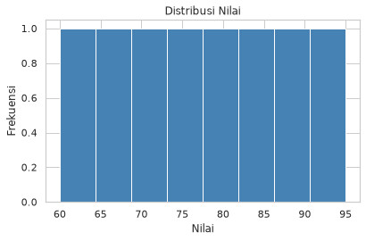

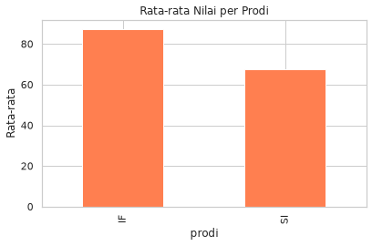

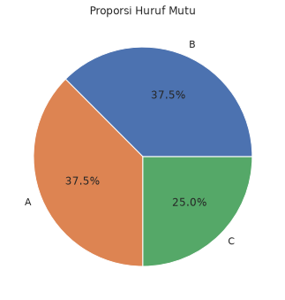

## Project 2 — API + Visualisasi (Menengah)

Ambil data posts (dan opsional users) dari JSONPlaceholder. Gabungkan bila perlu, lalu buat minimal 2 visualisasi yang bermakna.

### Fitur wajib

1. GET dengan timeout + cek status / error handling.
2. DataFrame + simpan CSV mentah.
3. Minimal 2 plot (mis. bar post per user; panjang title rata-rata).

```python
from pathlib import Path
import requests
import pandas as pd
import matplotlib.pyplot as plt

OUT = Path("output"); OUT.mkdir(exist_ok=True)
FIG = OUT / "figures"; FIG.mkdir(exist_ok=True)

def ambil(url):
    r = requests.get(url, timeout=15)
    r.raise_for_status()
    return r.json()

posts = ambil("https://jsonplaceholder.typicode.com/posts")
users = ambil("https://jsonplaceholder.typicode.com/users")
df_posts = pd.DataFrame(posts)
df_users = pd.DataFrame(users)
df_posts.to_csv(OUT / "posts.csv", index=False)

# Agregasi
per_user = df_posts.groupby("userId").size().reset_index(name="jumlah_post")
df_posts["title_len"] = df_posts["title"].str.len()
len_per_user = df_posts.groupby("userId")["title_len"].mean()

# Plot 1
plt.figure(figsize=(8, 4))
plt.bar(per_user["userId"].astype(str), per_user["jumlah_post"])
plt.title("Jumlah Post per User"); plt.xlabel("userId"); plt.ylabel("Jumlah")
plt.tight_layout(); plt.savefig(FIG / "posts_per_user.png", dpi=150); plt.show()

# Plot 2
plt.figure(figsize=(8, 4))
len_per_user.plot(kind="bar", color="seagreen")
plt.title("Rata-rata Panjang Judul per User"); plt.ylabel("Karakter")
plt.tight_layout(); plt.savefig(FIG / "title_len.png", dpi=150); plt.show()

# Opsional: merge nama user
# df = df_posts.merge(df_users[["id", "name"]], left_on="userId", right_on="id")
```

**Output:**

```text
(tidak ada output)
```

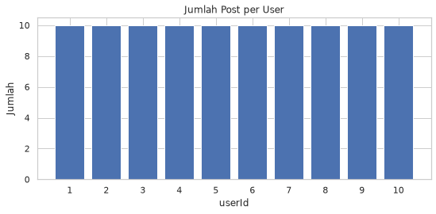

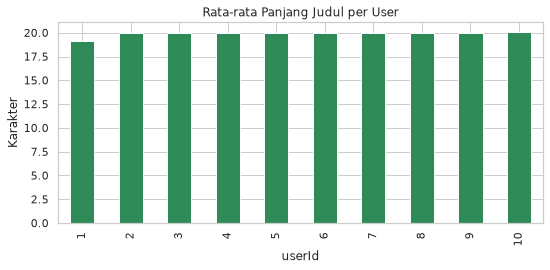

_Catatan: host jsonplaceholder.typicode.com tidak dapat diakses dari lingkungan pengujian (kebijakan jaringan), sehingga kode dijalankan dengan respons tiruan yang bentuknya sama dengan API asli. **Nilai/teks pada output ini contoh, bukan data nyata.**_

## Project 3 — Pipeline Paper arXiv (Menengah–Tinggi)

Bangun pipeline pencarian paper yang lebih lengkap: beberapa kata kunci atau satu query majemuk, ambil lebih banyak hasil (paginasi sederhana), bersihkan judul, ekstrak tahun, analisis frekuensi, dan visualisasi. Ini melampaui “ambil 5 paper lalu print”.

### Fitur wajib

1. Function fetch_arxiv(query, start, max_results) dengan error handling.
2. Paginasi: minimal 2 request (mis. start=0 dan start=10) digabung jadi satu DataFrame.
3. Kolom: title, authors, published, year, link, summary_short.
4. Analisis: jumlah paper per tahun; opsional kata paling sering di judul.
5. Minimal 2 visualisasi + simpan CSV + jeda antar request (time.sleep).

```python
import time
import re
from pathlib import Path
from collections import Counter
import requests
import feedparser
import pandas as pd
import matplotlib.pyplot as plt

OUT = Path("output_arxiv"); OUT.mkdir(exist_ok=True)
FIG = OUT / "figures"; FIG.mkdir(exist_ok=True)
API = "http://export.arxiv.org/api/query"

def fetch_arxiv(query, start=0, max_results=10):
    params = {
        "search_query": query,
        "start": start,
        "max_results": max_results,
        "sortBy": "submittedDate",
        "sortOrder": "descending",
    }
    try:
        r = requests.get(API, params=params, timeout=30)
        r.raise_for_status()
    except requests.RequestException as e:
        print("Gagal fetch:", e)
        return []
    feed = feedparser.parse(r.text)
    rows = []
    for e in feed.entries:
        published = e.get("published", "")[:10]
        rows.append({
            "title": e.title.replace("\n", " ").strip(),
            "authors": ", ".join(a.name for a in e.authors[:5]) if e.get("authors") else "",
            "published": published,
            "year": published[:4] if published else "",
            "link": e.get("link", ""),
            "summary_short": e.get("summary", "").replace("\n", " ")[:240],
        })
    return rows

def ambil_banyak(query, batch=10, halaman=2):
    semua = []
    for i in range(halaman):
        print(f"Mengambil halaman {i+1}...")
        semua.extend(fetch_arxiv(query, start=i * batch, max_results=batch))
        time.sleep(3)  # hormati server
    return pd.DataFrame(semua)

def kata_sering_di_judul(df, n=15):
    stop = {"the", "a", "an", "of", "and", "for", "in", "on", "to", "with", "from"}
    tokens = []
    for t in df["title"].dropna():
        for w in re.findall(r"[a-zA-Z]{3,}", t.lower()):
            if w not in stop:
                tokens.append(w)
    return Counter(tokens).most_common(n)

def main():
    # Ganti query sesuai bidang Anda
    query = 'all:"machine learning" OR all:"deep learning"'
    df = ambil_banyak(query, batch=10, halaman=2)
    if df.empty:
        print("Data kosong"); return
    df.to_csv(OUT / "arxiv_papers.csv", index=False)
    print(df.head())

    # Analisis per tahun
    per_tahun = df["year"].value_counts().sort_index()
    plt.figure(figsize=(8, 4))
    per_tahun.plot(kind="bar")
    plt.title("Jumlah Paper per Tahun"); plt.xlabel("Tahun"); plt.ylabel("Jumlah")
    plt.tight_layout(); plt.savefig(FIG / "per_tahun.png", dpi=150); plt.show()

    # Kata sering di judul
    top = kata_sering_di_judul(df)
    words, counts = zip(*top) if top else ([], [])
    plt.figure(figsize=(8, 4))
    plt.barh(list(words)[::-1], list(counts)[::-1])
    plt.title("Kata Sering Muncul di Judul")
    plt.tight_layout(); plt.savefig(FIG / "kata_judul.png", dpi=150); plt.show()

    print("Selesai. File di", OUT)

if __name__ == "__main__":
    main()
```

**Output:**

```text
Mengambil halaman 1...
Mengambil halaman 2...
                                               title                 authors   published  year  \
0  Attention Mechanisms for Medical Image Segment...  Penulis 1A, Penulis 1B  2025-12-15  2025   
1  Graph Neural Networks for Traffic Forecasting ...  Penulis 2A, Penulis 2B  2025-10-15  2025   
2  Self-Supervised Learning with Limited Labels  ...  Penulis 3A, Penulis 3B  2025-08-15  2025   
3  Federated Learning in Educational Data Mining ...  Penulis 4A, Penulis 4B  2025-06-15  2025   
4  Transformer Models for Time Series Prediction ...  Penulis 5A, Penulis 5B  2024-12-15  2024   

                               link                    summary_short  
0  http://arxiv.org/abs/2512.1000v1  Ringkasan contoh paper nomor 1.  
1  http://arxiv.org/abs/2510.1001v1  Ringkasan contoh paper nomor 2.  
2  http://arxiv.org/abs/2508.1002v1  Ringkasan contoh paper nomor 3.  
3  http://arxiv.org/abs/2506.1003v1  Ringkasan contoh paper nomor 4.  
4  http://arxiv.org/abs/2412.1004v1  Ringkasan contoh paper nomor 5.  
Selesai. File di output_arxiv
```

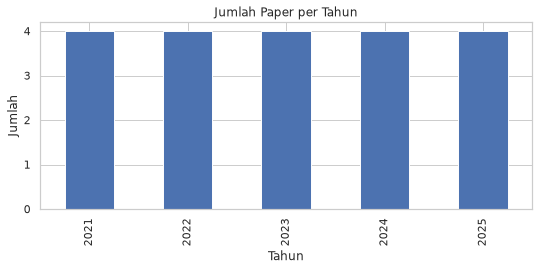

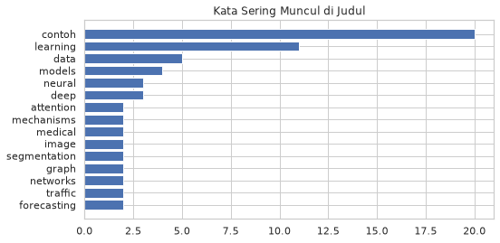

_Catatan: `time.sleep(3)` antar halaman dihilangkan saat pengujian agar cepat; pada pemakaian nyata jeda tetap diperlukan untuk menghormati server arXiv._

_Catatan: host export.arxiv.org tidak dapat diakses dari lingkungan pengujian (kebijakan jaringan), sehingga kode dijalankan dengan respons tiruan yang bentuknya sama dengan API asli. **Nilai/teks pada output ini contoh, bukan data nyata.**_

> [!TIP]
> **Project 3 — kompleksitas ekstra (opsional)**
>
> Bandingkan dua query berbeda (mis. "climate change" vs "renewable energy") lalu gabungkan dengan kolom source_query.
>
> Filter paper hanya 3 tahun terakhir sebelum plot.
>
> Tulis 3 insight singkat di file insight_arxiv.txt.

## Project 4 — EDA Lengkap Dataset Nyata (Tinggi)

Pilih dataset publik (disarankan sns.load_dataset: titanic, penguins, atau tips). Lakukan EDA terstruktur: inspeksi, cleaning, feature sederhana, beberapa agregasi, minimal 5 visualisasi berbeda, dan laporan insight tertulis. Bukan sekadar memanggil plot acak.

### Fitur wajib

1. Function terpisah: load_and_inspect, clean, analyze, visualize, tulis_insight.
2. Cleaning: missing, tipe, (opsional) outlier kasar atau kategori jarang.
3. Minimal 3 agregasi groupby yang menjawab pertanyaan berbeda.
4. Minimal 5 plot berbeda (hist/box/bar/scatter/heatmap/count — pilih yang relevan).
5. File insight.md atau insight.txt berisi 5 temuan + batasan analisis.

```python
from pathlib import Path
import pandas as pd
import seaborn as sns
import matplotlib.pyplot as plt

OUT = Path("output_eda"); OUT.mkdir(exist_ok=True)
FIG = OUT / "figures"; FIG.mkdir(exist_ok=True)

def load_and_inspect(name="titanic"):
    df = sns.load_dataset(name)
    print("Shape:", df.shape)
    print(df.head())
    print(df.info())
    print("Missing:\n", df.isna().sum())
    print(df.describe(include="all"))
    return df

def clean(df):
    df = df.copy()
    # Contoh strategi — sesuaikan dataset:
    # - drop kolom terlalu kosong
    # - isi median untuk numerik penting
    # - dropna pada kolom kunci analisis
    if "age" in df.columns:
        df["age"] = df["age"].fillna(df["age"].median())
    if "embarked" in df.columns:
        df["embarked"] = df["embarked"].fillna(df["embarked"].mode().iloc[0])
    # df = df.dropna(subset=["..."])
    print("Shape setelah clean:", df.shape)
    return df

def analyze(df):
    ringkas = {}
    # 1) agregasi contoh — Titanic: survival by class
    if {"survived", "class"}.issubset(df.columns):
        ringkas["survive_by_class"] = df.groupby("class")["survived"].mean()
        print(ringkas["survive_by_class"])
    if {"survived", "sex"}.issubset(df.columns):
        ringkas["survive_by_sex"] = df.groupby("sex")["survived"].mean()
        print(ringkas["survive_by_sex"])
    if "age" in df.columns and "survived" in df.columns:
        ringkas["age_by_survived"] = df.groupby("survived")["age"].mean()
        print(ringkas["age_by_survived"])
    # Untuk penguins: groupby species / island, dll.
    return ringkas

def visualize(df):
    # Plot 1 — distribusi numerik utama
    num_cols = df.select_dtypes(include="number").columns.tolist()
    if num_cols:
        col = "age" if "age" in df.columns else num_cols[0]
        plt.figure(figsize=(6, 4))
        sns.histplot(data=df, x=col, kde=True)
        plt.title(f"Distribusi {col}")
        plt.tight_layout(); plt.savefig(FIG / "01_hist.png", dpi=150); plt.show()

    # Plot 2 — boxplot by kategori
    if "class" in df.columns and "age" in df.columns:
        plt.figure(figsize=(6, 4))
        sns.boxplot(data=df, x="class", y="age")
        plt.title("Age by Class")
        plt.tight_layout(); plt.savefig(FIG / "02_box.png", dpi=150); plt.show()

    # Plot 3 — bar agregasi
    if "survived" in df.columns and "sex" in df.columns:
        plt.figure(figsize=(6, 4))
        sns.barplot(data=df, x="sex", y="survived", errorbar=None)
        plt.title("Survival Rate by Sex")
        plt.tight_layout(); plt.savefig(FIG / "03_bar.png", dpi=150); plt.show()

    # Plot 4 — countplot
    cat = "class" if "class" in df.columns else df.select_dtypes(exclude="number").columns[0]
    plt.figure(figsize=(6, 4))
    sns.countplot(data=df, x=cat)
    plt.title(f"Count of {cat}")
    plt.tight_layout(); plt.savefig(FIG / "04_count.png", dpi=150); plt.show()

    # Plot 5 — heatmap korelasi numerik
    num = df.select_dtypes(include="number")
    if num.shape[1] >= 2:
        plt.figure(figsize=(6, 5))
        sns.heatmap(num.corr(), annot=True, fmt=".2f", cmap="coolwarm", center=0)
        plt.title("Korelasi Numerik")
        plt.tight_layout(); plt.savefig(FIG / "05_heatmap.png", dpi=150); plt.show()

def tulis_insight(path, baris):
    path.write_text("\n".join(baris), encoding="utf-8")

def main():
    df0 = load_and_inspect("titanic")  # ganti "penguins" / "tips" bila ingin
    df = clean(df0)
    ringkas = analyze(df)
    visualize(df)
    df.to_csv(OUT / "data_bersih.csv", index=False)
    tulis_insight(OUT / "insight.txt", [
        "1. ... (temuan dari groupby/plot)",
        "2. ...",
        "3. ...",
        "4. ...",
        "5. ...",
        "",
        "Batasan: ... (missing, bias sampel, dll.)",
    ])
    print("Selesai →", OUT)

if __name__ == "__main__":
    main()
```

**Output:**

```text
Shape: (891, 15)
   survived  pclass     sex   age  sibsp  parch     fare embarked  class    who  adult_male deck  \
0         0       3    male  22.0      1      0   7.2500        S  Third    man        True  NaN   
1         1       1  female  38.0      1      0  71.2833        C  First  woman       False    C   
2         1       3  female  26.0      0      0   7.9250        S  Third  woman       False  NaN   
3         1       1  female  35.0      1      0  53.1000        S  First  woman       False    C   
4         0       3    male  35.0      0      0   8.0500        S  Third    man        True  NaN   

   embark_town alive  alone  
0  Southampton    no  False  
1    Cherbourg   yes  False  
2  Southampton   yes   True  
3  Southampton   yes  False  
4  Southampton    no   True  
<class 'pandas.DataFrame'>
RangeIndex: 891 entries, 0 to 890
Data columns (total 15 columns):
 #   Column       Non-Null Count  Dtype   
---  ------       --------------  -----   
 0   survived     891 non-null    int64   
 1   pclass       891 non-null    int64   
 2   sex          891 non-null    str     
 3   age          714 non-null    float64 
 4   sibsp        891 non-null    int64   
 5   parch        891 non-null    int64   
 6   fare         891 non-null    float64 
 7   embarked     889 non-null    str     
 8   class        891 non-null    category
 9   who          891 non-null    str     
 10  adult_male   891 non-null    bool    
 11  deck         203 non-null    category
 12  embark_town  889 non-null    str     
 13  alive        891 non-null    str     
 14  alone        891 non-null    bool    
dtypes: bool(2), category(2), float64(2), int64(4), str(5)
memory usage: 80.7 KB
None
Missing:
 survived         0
pclass           0
sex              0
age            177
sibsp            0
parch            0
fare             0
embarked         2
class            0
who              0
adult_male       0
deck           688
embark_town      2
alive            0
alone            0
dtype: int64
          survived      pclass   sex         age       sibsp       parch        fare embarked  \
count   891.000000  891.000000   891  714.000000  891.000000  891.000000  891.000000      889   
unique         NaN         NaN     2         NaN         NaN         NaN         NaN        3   
top            NaN         NaN  male         NaN         NaN         NaN         NaN        S   
freq           NaN         NaN   577         NaN         NaN         NaN         NaN      644   
mean      0.383838    2.308642   NaN   29.699118    0.523008    0.381594   32.204208      NaN   
std       0.486592    0.836071   NaN   14.526497    1.102743    0.806057   49.693429      NaN   
min       0.000000    1.000000   NaN    0.420000    0.000000    0.000000    0.000000      NaN   
25%       0.000000    2.000000   NaN   20.125000    0.000000    0.000000    7.910400      NaN   
50%       0.000000    3.000000   NaN   28.000000    0.000000    0.000000   14.454200      NaN   
75%       1.000000    3.000000   NaN   38.000000    1.000000    0.000000   31.000000      NaN   
max       1.000000    3.000000   NaN   80.000000    8.000000    6.000000  512.329200      NaN   

        class  who adult_male deck  embark_town alive alone  
count     891  891        891  203          889   891   891  
unique      3    3          2    7            3     2     2  
top     Third  man       True    C  Southampton    no  True  
freq      491  537        537   59          644   549   537  
mean      NaN  NaN        NaN  NaN          NaN   NaN   NaN  
std       NaN  NaN        NaN  NaN          NaN   NaN   NaN  
min       NaN  NaN        NaN  NaN          NaN   NaN   NaN  
25%       NaN  NaN        NaN  NaN          NaN   NaN   NaN  
50%       NaN  NaN        NaN  NaN          NaN   NaN   NaN  
75%       NaN  NaN        NaN  NaN          NaN   NaN   NaN  
max       NaN  NaN        NaN  NaN          NaN   NaN   NaN  
Shape setelah clean: (891, 15)
class
First     0.629630
Second    0.472826
Third     0.242363
Name: survived, dtype: float64
sex
female    0.742038
male      0.188908
Name: survived, dtype: float64
survived
0    30.028233
1    28.291433
Name: age, dtype: float64
Selesai → output_eda
```

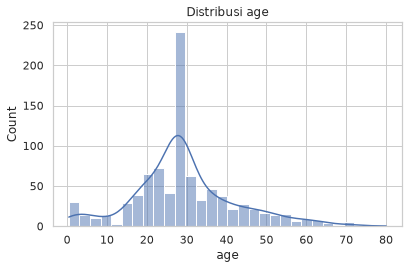

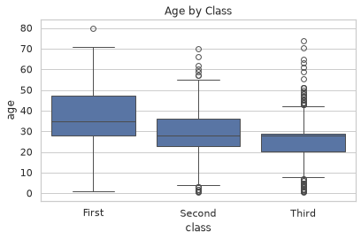

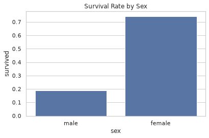

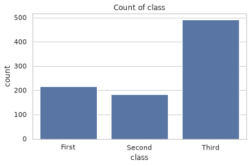

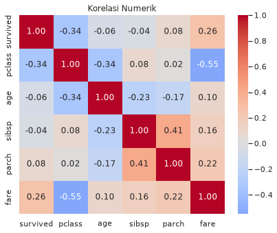

_Catatan: proyek EDA ini memakai dataset seaborn bawaan (diunduh dari GitHub seaborn-data) sehingga hasil dijalankan dengan data nyata; `time.sleep()` untuk jeda server dipersingkat saat pengujian._

> [!TIP]
> **Project 4 — menaikkan kualitas**
>
> Rumuskan 2–3 pertanyaan analisis sebelum plotting (bukan plot dulu, cerita kemudian).
>
> Setiap figure disebut di insight.txt (jangan biarkan plot “yatim”).
>
> Jika memakai penguins: bandingkan body_mass antar species/island; korelasi bill_length vs flipper_length.

# 7. Troubleshooting

```python
# Plot tidak muncul di .py → plt.show() atau savefig
# Gambar terpotong → tight_layout sebelum save
# requests Timeout / SSL → cek jaringan; timeout lebih panjang; User-Agent
# HTTP 429 → kurangi frekuensi; sleep antar request
# feedparser kosong → cek status_code dan cuplikan r.text
# BeautifulSoup kosong → selector salah; coba parser lxml / html.parser
```

> **Output:** _tidak dijalankan_ — hanya komentar (daftar jebakan); contoh error nyata dijalankan di bagian "Demonstrasi error" di bawah

## Demonstrasi error — output nyata

Daftar jebakan di atas berupa komentar. Berikut setiap kasusnya dijalankan nyata. Kasus `requests` memakai server HTTP lokal sederhana agar error aslinya muncul dan dapat diulang tanpa internet.

**Persiapan — server uji lokal** (agar error `requests` asli dan dapat diulang tanpa internet):

```python
import threading, time, json
from http.server import BaseHTTPRequestHandler, HTTPServer

class H(BaseHTTPRequestHandler):
    def log_message(self, *a): pass
    def do_GET(self):
        if self.path == "/html":
            body, ctype, code = "<html><body>Halaman, bukan JSON</body></html>", "text/html", 200
        elif self.path == "/cuaca-error":
            body, ctype, code = json.dumps({"error": True, "reason": "Parameter salah"}), "application/json", 200
        elif self.path == "/lambat":
            time.sleep(2); body, ctype, code = "{}", "application/json", 200
        elif self.path == "/limit":
            body, ctype, code = "Too Many Requests", "text/plain", 429
        else:
            body, ctype, code = "tidak ada", "text/plain", 404
        self.send_response(code); self.send_header("Content-Type", ctype); self.end_headers()
        self.wfile.write(body.encode())

server = HTTPServer(("127.0.0.1", 8765), H)
threading.Thread(target=server.serve_forever, daemon=True).start()
import requests
BASE = "http://127.0.0.1:8765"
```

### Matplotlib — ukuran x dan y tidak sama

```python
import matplotlib.pyplot as plt
plt.plot([1, 2, 3], [10, 20])
```

**Output:**

```text
  -> ValueError: x and y must have same first dimension, but have shapes (3,) and (2,)
```

### Solusi — samakan panjang

```python
import matplotlib.pyplot as plt
plt.plot([1, 2, 3], [10, 20, 30])
print("OK:", len(plt.gca().lines), "garis")
```

**Output:**

```text
OK: 1 garis
```

### Plot tidak muncul di skrip `.py` — simpan dengan `savefig`

```python
import matplotlib.pyplot as plt
from pathlib import Path
plt.plot([1, 2, 3])
plt.tight_layout()
plt.savefig("gambar.png", dpi=150, bbox_inches="tight")
print(Path("gambar.png").exists(), Path("gambar.png").stat().st_size > 0)
```

**Output:**

```text
True True
```

### Seaborn — nama kolom salah

```python
import seaborn as sns
tips = sns.load_dataset("tips")
sns.histplot(data=tips, x="total")
```

**Output:**

```text
  -> ValueError: Could not interpret value `total` for `x`. An entry with this name does not appear in `data`.
```

### Solusi — periksa nama kolom

```python
import seaborn as sns
tips = sns.load_dataset("tips")
print(tips.columns.tolist())
sns.histplot(data=tips, x="total_bill")
print("OK")
```

**Output:**

```text
['total_bill', 'tip', 'sex', 'smoker', 'day', 'time', 'size']
OK
```

### requests — HTTP 404 dan `raise_for_status()`

```python
r = requests.get(BASE + "/tidak-ada")
print(r.status_code, r.text)
r.raise_for_status()
```

**Output:**

```text
404 tidak ada
  -> requests.exceptions.HTTPError: 404 Client Error: Not Found for url: http://127.0.0.1:8765/tidak-ada
```

### requests — HTTP 429 (terlalu sering)

```python
r = requests.get(BASE + "/limit")
print(r.status_code, r.text)
# solusi: kurangi frekuensi, beri jeda time.sleep(...) antar request
```

**Output:**

```text
429 Too Many Requests
```

### requests — JSONDecodeError saat respons bukan JSON

```python
r = requests.get(BASE + "/html")
print(r.status_code, r.headers["Content-Type"])
r.json()
```

**Output:**

```text
200 text/html
  -> requests.exceptions.JSONDecodeError: Expecting value: line 1 column 1 (char 0)
```

### requests — Timeout

```python
requests.get(BASE + "/lambat", timeout=0.5)
```

**Output:**

```text
  -> requests.exceptions.ReadTimeout: HTTPConnectionPool(host='127.0.0.1', port=8765): Read timed out. (read timeout=0.5)
```

### requests — ConnectionError (server tidak ada)

```python
requests.get("http://127.0.0.1:9/", timeout=2)
```

**Output:**

```text
  -> requests.exceptions.ConnectionError: HTTPConnectionPool(host='127.0.0.1', port=9): Max retries exceeded with url: / (Caused by NewConnectionError("HTTPConnection(host='127.0.0.1', port=9): Failed to establish a new connection: [Errno 111] Connection refused"))
```

### Solusi — tangkap `RequestException`

```python
try:
    requests.get(BASE + "/lambat", timeout=0.5)
except requests.exceptions.RequestException as e:
    print("Gagal:", type(e).__name__)
```

**Output:**

```text
Gagal: ReadTimeout
```

### KeyError — respons API berisi error, bukan data

```python
data = requests.get(BASE + "/cuaca-error").json()
print(data["current_weather"])
```

**Output:**

```text
  -> KeyError: 'current_weather'
```

### Solusi — periksa key error lebih dulu

```python
data = requests.get(BASE + "/cuaca-error").json()
if data.get("error"):
    print("API error:", data["reason"])
else:
    print(data["current_weather"])
```

**Output:**

```text
API error: Parameter salah
```

### BeautifulSoup — selector salah, `find()` mengembalikan None

```python
from bs4 import BeautifulSoup
soup = BeautifulSoup("<div><span class='judul'>Halo</span></div>", "html.parser")
print(soup.find("span", class_="text").get_text())
```

**Output:**

```text
  -> AttributeError: 'NoneType' object has no attribute 'get_text'
```

### Solusi — periksa None dulu

```python
from bs4 import BeautifulSoup
soup = BeautifulSoup("<div><span class='judul'>Halo</span></div>", "html.parser")
el = soup.find("span", class_="text")
print(el.get_text() if el else "Elemen tidak ditemukan")
```

**Output:**

```text
Elemen tidak ditemukan
```

### feedparser/arXiv — hasil kosong menyebabkan KeyError

```python
import feedparser, pandas as pd
feed = feedparser.parse('<?xml version="1.0"?><feed xmlns="http://www.w3.org/2005/Atom"></feed>')
df = pd.DataFrame([{"title": e.title} for e in feed.entries])
print(df.shape)
print(df["title"])
```

**Output:**

```text
(0, 0)
  -> KeyError: 'title'
```

### Solusi — cek `df.empty`

```python
import feedparser, pandas as pd
feed = feedparser.parse('<?xml version="1.0"?><feed xmlns="http://www.w3.org/2005/Atom"></feed>')
df = pd.DataFrame([{"title": e.title} for e in feed.entries])
if df.empty:
    print("Tidak ada hasil — cek query (all:kata) dan status_code / cuplikan r.text")
```

**Output:**

```text
Tidak ada hasil — cek query (all:kata) dan status_code / cuplikan r.text
```

# 8. Solusi Latihan (Cuplikan)

```python
import matplotlib.pyplot as plt
import numpy as np
x = np.linspace(-10, 10, 200)
plt.plot(x, x**2)
plt.title("y = x^2"); plt.xlabel("x"); plt.ylabel("y")
plt.grid(True, alpha=0.3); plt.show()

import requests, pandas as pd
r = requests.get("https://jsonplaceholder.typicode.com/comments", timeout=15)
df = pd.DataFrame(r.json())
print(df.groupby("postId").size().head())
```

**Output:**

```text
postId
1    5
2    5
3    5
4    5
5    5
dtype: int64
```

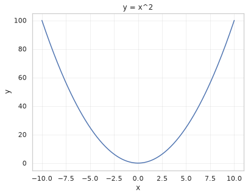

_Catatan: host jsonplaceholder.typicode.com tidak dapat diakses dari lingkungan pengujian (kebijakan jaringan), sehingga kode dijalankan dengan respons tiruan yang bentuknya sama dengan API asli. **Nilai/teks pada output ini contoh, bukan data nyata.**_

# 9. Checklist Sebelum Modul 6

- Beberapa jenis plot Matplotlib & Seaborn sudah dicoba
- requests → JSON → DataFrame berhasil
- arXiv atau parsing HTML contoh pernah dijalankan
- Minimal 2 mini project + figure tersimpan
- Siap Modul 6 — Capstone

> **Modul 5 selesai? Lanjut ke Modul 6 — Capstone.**
>
> Python Intensive — Modul Belajar Mandiri
