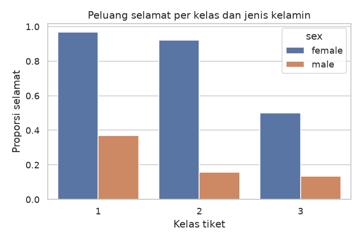
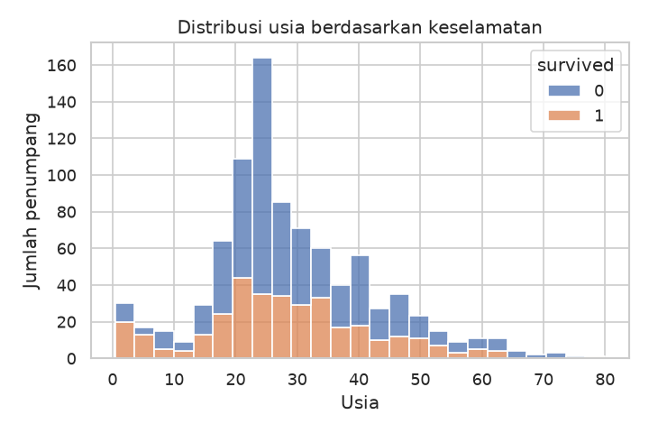
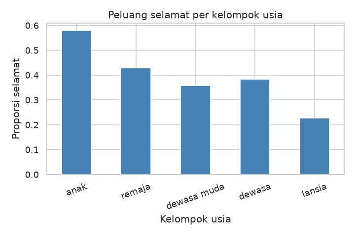

# Modul 6 — Capstone Project

_Proyek akhir mandiri  ·  Integrasi Modul 1–5  ·  Dokumentasi portfolio · Estimasi: ± 6–10 jam (tergantung scope)  ·  Prasyarat: Modul 1–5_

> **Catatan pengujian:** blok kode pada modul ini dijalankan (Python 3.11, pandas 3.0.6, matplotlib 3.11.2, seaborn 0.13.2). Modul 6 versi ini berisi kerangka (skeleton), sehingga ditambahkan **contoh lengkap** yang mengisi skeleton untuk Jalur A dan "Demonstrasi error" untuk kasus teknis pada Troubleshooting. Contoh lengkap keempat jalur ada di `contoh-capstone/`. Folder struktur dan template README pada modul asli berlabel `python`; di sini dilabeli `text`/`markdown` agar terbaca benar.

# 1. Apa Itu Capstone di Modul Ini

Capstone adalah proyek penutup: Anda memilih satu masalah, lalu menyelesaikan alur end-to-end dengan keterampilan yang sudah dipelajari — dari struktur data, function, dan OOP hingga Pandas, visualisasi, dan (bila relevan) API.

Bukan ujian pilihan ganda. Yang penting adalah kejelasan masalah, kualitas data dan kode, ketepatan analisis, visualisasi yang mendukung argumen, serta dokumentasi yang bisa dipahami orang lain.

> [!NOTE]
> **Prinsip**
>
> Lebih baik scope kecil yang selesai rapi daripada ide besar yang setengah jadi.
>
> Setiap figure dan tabel harus punya alasan (menjawab pertanyaan analisis).
>
> Simpan semua artefak di satu folder proyek agar siap dimasukkan portfolio.

# 2. Tujuan Pembelajaran

- Merumuskan pertanyaan analisis yang dapat dijawab dengan data.
- Menjalankan pipeline: data → cleaning → analisis → visualisasi → kesimpulan.
- Menulis kode terstruktur (function/module secukupnya) dan dapat dijalankan ulang.
- Menyusun dokumentasi singkat yang layak portfolio.

# 3. Memilih Topik

## 3.1 Kriteria topik yang sehat

Topik yang baik punya data yang bisa diakses, pertanyaan yang jelas, dan hasil yang bisa divisualisasikan. Hindari topik yang membutuhkan data rahasia, scraping agresif, atau model ML berat jika Anda belum mempelajarinya di modul ini.

## 3.2 Ide yang disarankan

| Tema | Sumber data contoh | Pertanyaan contoh |
|---|---|---|
| Nilai / akademik | CSV sendiri / generate | Faktor apa terkait IPK tinggi? |
| Dataset Seaborn | titanic, tips, penguins | Siapa lebih mungkin survive? |
| API publik | Open-Meteo, JSONPlaceholder | Bagaimana pola suhu 7 hari? |
| Literatur arXiv | arXiv API | Topik apa sering di keyword X? |
| Operasional mini | CSV inventori / perpustakaan | Item apa sering kosong? |

> [!TIP]
> **Tips memilih**
>
> Kaitkan dengan jurusan Anda bila memungkinkan (lebih bermakna di portfolio).
>
> Pastikan Anda bisa menjelaskan data kepada orang awam dalam 2 menit.
>
> Jika data sulit didapat dalam 1 jam, ganti sumber — jangan habiskan waktu hanya mencari CSV.

# 4. Deliverable Wajib

1. Kode yang bisa dijalankan (script .py atau notebook .ipynb).
2. Data mentah dan/atau data bersih (CSV) — atau skrip yang mengunduh data.
3. Minimal 3 visualisasi bermakna (PNG) dengan judul dan label.
4. Dokumentasi proyek (template di bagian 7).
5. Ringkasan insight: minimal 5 poin + batasan analisis.

# 5. Alur Kerja yang Disarankan

1. Rumuskan 2–4 pertanyaan analisis (tulis di dokumentasi dulu).
2. Kumpulkan / muat data; inspeksi (head, info, missing).
3. Cleaning dan transformasi; simpan data_bersih.csv.
4. Analisis (groupby, merge, statistik deskriptif).
5. Visualisasi yang menjawab pertanyaan — bukan dekorasi.
6. Tulis insight + batasan; rapikan struktur folder.
7. Uji ulang: jalankan dari awal bila memungkinkan.

# 5b. Agenda Sehari & Alokasi Waktu


| Waktu | Sesi | Durasi | Fokus |
|---|---|---|---|
| 00:00–00:20 | Briefing + Pemilihan Topik | 20 mnt | Orientasi |
| 00:20–01:00 | Perencanaan (outline + struktur) | 40 mnt | Design |
| 01:00–04:00 | Pengerjaan Capstone | 180 mnt | Implementasi |
| 04:00–04:20 | Istirahat | 20 mnt | — |
| 04:20–05:20 | Finalisasi + Dokumentasi | 60 mnt | Polish |
| 05:20–06:00 | Showcase / Review | 40 mnt | Presentasi |

## 5b.1 Saran alokasi waktu saat Coding (180 menit)

| Tahap | Waktu | Aktivitas |
|---|---|---|
| Load + Inspeksi | 20 mnt | Baca data, cek shape/dtypes/missing/duplikat |
| Cleaning | 25 mnt | Tangani missing, duplikat, tipe data |
| Analisis | 40 mnt | Groupby, pivot, korelasi, filter, ranking |
| Visualisasi | 45 mnt | Minimal 4–5 grafik, judul & label jelas |
| Insight + Export | 25 mnt | Tulis insight, simpan CSV/Excel |
| Buffer / Perbaikan | 25 mnt | Cadangan jika ada error |

> **Tips Time Management**
>
> Jangan terlalu lama di tahap cleaning. Cleaning yang cukup baik lebih baik daripada sempurna tapi kehabisan waktu.
>
> Kerjakan visualisasi paling penting dulu.
>
> Simpan file sesering mungkin.

## 5b.2 Ekspektasi kualitas kode

> **Standar Kode yang Diharapkan**
>
> Nama variabel dan fungsi bermakna.
>
> Minimal ada beberapa function (atau class) — jangan semua kode di top-level.
>
> Ada docstring singkat pada function/class utama.
>
> Mengikuti PEP 8 secara wajar.
>
> Ada error handling pada bagian yang berisiko (baca file, panggil API).
>
> Kode dapat dijalankan dari atas ke bawah tanpa error.

## 5b.3 Rekomendasi dataset & sumber data

| Dataset / Sumber | Cocok untuk | Keterangan |
|---|---|---|
| Student Performance | Jalur A | Kaggle / UCI — nilai, gender, pendidikan ortu |
| Titanic | Jalur A | Kaggle — klasik untuk EDA |
| Iris / Penguins | Jalur A | Seaborn bawaan — kecil dan bersih |
| Gapminder | Jalur A | Data pembangunan dunia |
| JSONPlaceholder | Jalur B | API palsu — users, posts |
| Open-Meteo | Jalur B | API cuaca gratis tanpa key |
| arXiv API | Jalur B | Metadata paper ilmiah — cocok S2/S3 |
| Data nilai buatan sendiri | Jalur D | Buat CSV sendiri atau generate |

# 6. Struktur Folder Proyek

```text
capstone_nama_anda/
├── README.md
├── requirements.txt
├── data/
│   ├── raw/
│   └── processed/
├── src/                   # atau notebooks/
│   ├── 01_load_clean.py
│   ├── 02_analyze.py
│   └── 03_visualize.py
├── figures/
└── output/
    ├── ringkasan.csv
    └── insight.txt
```

Tidak wajib memecah 3 file Python; satu notebook rapi juga diterima. Yang penting alurnya jelas.

# 7. Template Dokumentasi Capstone

Salin struktur berikut ke README.md dan isi dengan kata Anda sendiri.

```markdown
# Judul Proyek

## 1. Latar belakang & motivasi
## 2. Pertanyaan analisis
## 3. Data (sumber, ukuran, cara dapat, etika)
## 4. Metode (cleaning, analisis, tools)
## 5. Hasil utama (temuan + rujukan figure)
## 6. Visualisasi (daftar figure + arti singkat)
## 7. Batasan
## 8. Kesimpulan & kerja lanjutan
## 9. Cara menjalankan
## 10. Struktur folder (opsional)
```

# 8. Skeleton Kode Capstone (Pola Umum)

Sesuaikan nama function dan kolom dengan topik Anda.

```python
from pathlib import Path
import pandas as pd
import matplotlib.pyplot as plt
import seaborn as sns

ROOT = Path(__file__).resolve().parent.parent
DATA_RAW = ROOT / "data" / "raw"
DATA_OUT = ROOT / "data" / "processed"
FIG = ROOT / "figures"
OUT = ROOT / "output"
for d in [DATA_OUT, FIG, OUT]:
    d.mkdir(parents=True, exist_ok=True)

def load_data():
    # pd.read_csv / sns.load_dataset / requests
    raise NotImplementedError

def clean(df):
    df = df.copy()
    # missing, tipe, filter, feature
    return df

def analyze(df):
    hasil = {}
    # groupby / agregasi → simpan di hasil
    return hasil

def visualize(df, hasil):
    # minimal 3 plot; savefig ke FIG
    pass

def tulis_insight(hasil, path):
    path.write_text("1. ...\n2. ...\n\nBatasan: ...", encoding="utf-8")

def main():
    df0 = load_data()
    df = clean(df0)
    df.to_csv(DATA_OUT / "data_bersih.csv", index=False)
    hasil = analyze(df)
    visualize(df, hasil)
    tulis_insight(hasil, OUT / "insight.txt")
    print("Selesai.")

if __name__ == "__main__":
    main()
```

**Output** (skeleton dijalankan apa adanya sebagai `src/main.py`):

```text
Traceback (most recent call last):
  File "capstone_contoh/src/main.py", line 45, in <module>
    main()
  File "capstone_contoh/src/main.py", line 36, in main
    df0 = load_data()
  File "capstone_contoh/src/main.py", line 16, in load_data
    raise NotImplementedError
NotImplementedError
```

_Catatan: ini perilaku yang benar — skeleton sengaja memanggil `raise NotImplementedError` pada `load_data()` sampai Anda mengisinya. Perhatikan juga bahwa `Path(__file__)` hanya valid di skrip `.py`; di notebook pakai `Path.cwd()` (lihat Demonstrasi error)._

## Contoh lengkap — skeleton diisi untuk Jalur A (Titanic)

Berikut skeleton yang sama dengan semua function terisi (data: `sns.load_dataset("titanic")`, diunduh dari seaborn-data). Dijalankan sebagai `src/main.py` pada folder proyek kosong.

```python
from pathlib import Path
import pandas as pd
import matplotlib.pyplot as plt
import seaborn as sns

ROOT = Path(__file__).resolve().parent.parent
DATA_RAW = ROOT / "data" / "raw"
DATA_OUT = ROOT / "data" / "processed"
FIG = ROOT / "figures"
OUT = ROOT / "output"
for d in [DATA_OUT, FIG, OUT]:
    d.mkdir(parents=True, exist_ok=True)

def load_data():
    raw = DATA_RAW / "titanic.csv"
    if raw.exists():
        return pd.read_csv(raw)
    DATA_RAW.mkdir(parents=True, exist_ok=True)
    df = sns.load_dataset("titanic")      # unduh dari seaborn-data
    df.to_csv(raw, index=False)           # simpan mentah sejak request pertama
    return df

def clean(df):
    df = df.copy()
    df["age"] = df["age"].fillna(df.groupby(["pclass", "sex"])["age"].transform("median"))
    df["embarked"] = df["embarked"].fillna(df["embarked"].mode()[0])
    df = df.drop(columns=["deck", "alive", "class", "embark_town"])
    df["family_size"] = df["sibsp"] + df["parch"] + 1
    df["age_group"] = pd.cut(df["age"], [0, 12, 18, 35, 60, 100],
                             labels=["anak", "remaja", "dewasa muda", "dewasa", "lansia"])
    return df

def analyze(df):
    hasil = {}
    hasil["sex"] = df.groupby("sex")["survived"].mean()
    hasil["kelas"] = df.groupby("pclass")["survived"].mean()
    hasil["usia"] = df.groupby("age_group", observed=True)["survived"].mean()
    hasil["keluarga"] = df.groupby("family_size")["survived"].agg(["count", "mean"])
    hasil["pivot"] = df.pivot_table(values="survived", index="sex", columns="pclass", aggfunc="mean")
    hasil["median_usia"] = df.groupby("survived")["age"].median()
    return hasil

def visualize(df, hasil):
    sns.set_theme(style="whitegrid")

    plt.figure(figsize=(6, 4))
    sns.barplot(data=df, x="pclass", y="survived", hue="sex", errorbar=None)
    plt.title("Peluang selamat per kelas dan jenis kelamin")
    plt.xlabel("Kelas tiket"); plt.ylabel("Proporsi selamat")
    plt.tight_layout(); plt.savefig(FIG / "01_kelas_sex.png", dpi=120); plt.close()

    plt.figure(figsize=(6, 4))
    sns.histplot(data=df, x="age", hue="survived", bins=25, multiple="stack")
    plt.title("Distribusi usia berdasarkan keselamatan")
    plt.xlabel("Usia"); plt.ylabel("Jumlah penumpang")
    plt.tight_layout(); plt.savefig(FIG / "02_usia.png", dpi=120); plt.close()

    plt.figure(figsize=(6, 4))
    hasil["usia"].plot(kind="bar", color="steelblue")
    plt.title("Peluang selamat per kelompok usia")
    plt.xlabel("Kelompok usia"); plt.ylabel("Proporsi selamat"); plt.xticks(rotation=20)
    plt.tight_layout(); plt.savefig(FIG / "03_kelompok_usia.png", dpi=120); plt.close()

def tulis_insight(hasil, path):
    s, k, u = hasil["sex"], hasil["kelas"], hasil["usia"]
    baris = [
        f"1. Perempuan selamat {s['female']:.0%} vs laki-laki {s['male']:.0%} (lihat figure 01).",
        f"2. Kelas 1 selamat {k[1]:.0%}, kelas 3 hanya {k[3]:.0%} (figure 01).",
        f"3. Anak-anak selamat {u['anak']:.0%}, dewasa muda {u['dewasa muda']:.0%} (figure 03).",
        f"4. Median usia: selamat {hasil['median_usia'][1]:.0f} tahun vs tidak selamat {hasil['median_usia'][0]:.0f} tahun (figure 02).",
        f"5. Penumpang sendirian selamat {hasil['keluarga'].loc[1, 'mean']:.0%} dibanding keluarga 2 orang {hasil['keluarga'].loc[2, 'mean']:.0%}.",
        "",
        "Batasan: data observasional satu kejadian; usia diimputasi (median per kelas & jenis kelamin); "
        "tidak ada ID penumpang sehingga tidak bisa dikaitkan antar anggota keluarga.",
    ]
    path.write_text("\n".join(baris), encoding="utf-8")

def main():
    df0 = load_data()
    df = clean(df0)
    df.to_csv(DATA_OUT / "data_bersih.csv", index=False)
    hasil = analyze(df)
    visualize(df, hasil)
    tulis_insight(hasil, OUT / "insight.txt")
    hasil["pivot"].round(3).to_csv(OUT / "ringkasan.csv")
    print("Selesai.")

if __name__ == "__main__":
    main()

```

**Output:**

```text
Selesai.
```

Berkas yang terbentuk setelah dijalankan (sesuai struktur folder bagian 6):

```text
data/processed/data_bersih.csv
data/raw/titanic.csv
figures/01_kelas_sex.png
figures/02_usia.png
figures/03_kelompok_usia.png
output/insight.txt
output/ringkasan.csv
src/main.py
```

`output/insight.txt`:

```text
1. Perempuan selamat 74% vs laki-laki 19% (lihat figure 01).
2. Kelas 1 selamat 63%, kelas 3 hanya 24% (figure 01).
3. Anak-anak selamat 58%, dewasa muda 36% (figure 03).
4. Median usia: selamat 27 tahun vs tidak selamat 25 tahun (figure 02).
5. Penumpang sendirian selamat 30% dibanding keluarga 2 orang 55%.

Batasan: data observasional satu kejadian; usia diimputasi (median per kelas & jenis kelamin); tidak ada ID penumpang sehingga tidak bisa dikaitkan antar anggota keluarga.
```

`output/ringkasan.csv` (pivot peluang selamat: jenis kelamin × kelas):

```csv
sex,1,2,3
female,0.968,0.921,0.5
male,0.369,0.157,0.135
```

`data/processed/data_bersih.csv` (4 baris pertama):

```csv
survived,pclass,sex,age,sibsp,parch,fare,embarked,who,adult_male,alone,family_size,age_group
0,3,male,22.0,1,0,7.25,S,man,True,False,2,dewasa muda
1,1,female,38.0,1,0,71.2833,C,woman,False,False,2,dewasa
1,3,female,26.0,0,0,7.925,S,woman,False,True,1,dewasa muda
```

Tiga grafik yang dihasilkan di folder `figures/`:







**Uji ulang dari awal** (checklist "kode berjalan dari awal"): menjalankan `src/main.py` untuk kedua kalinya memakai data mentah yang sudah tersimpan dan menghasilkan `insight.txt` yang identik dengan sebelumnya:

```text
Selesai.
```

_Catatan: ini hanya contoh bentuk pengerjaan. Contoh capstone lengkap untuk keempat jalur (dengan dokumentasi dan output) ada di `contoh-capstone/`._

# 9. Empat Jalur Capstone (Pilih Satu)

## Jalur A — EDA Dataset Publik (paling stabil)

Pilih titanic / penguins / tips / CSV publik. Fokus pada pertanyaan, cleaning, groupby, dan 4–6 visualisasi yang saling terkait. Cocok jika koneksi API tidak andal.

### Scope minimum

1. 3 pertanyaan analisis tertulis.
2. Cleaning terdokumentasi + data_bersih.csv.
3. Minimal 3 groupby/agregasi berbeda.
4. Minimal 4 figure + insight 5 poin + batasan.

## Jalur B — API → Analisis → Visualisasi

Ambil data dari API publik yang legal. Simpan mentah, proses, visualisasikan tren atau perbandingan. Sertakan error handling dan catatan waktu pengambilan.

### Scope minimum

1. Function fetch dengan timeout dan penanganan gagal.
2. CSV mentah + CSV olahan.
3. Minimal 3 figure; insight mengaitkan angka dengan konteks.

## Jalur C — arXiv / literatur + ringkasan kuantitatif

Pipeline pencarian paper terkait bidang studi: paginasi, metadata, analisis waktu dan kata kunci, visualisasi, interpretasi untuk audiens akademik.

### Scope minimum

1. Minimal sekitar 20 paper (paginasi + sleep antar request).
2. Analisis per tahun + frekuensi kata judul (atau penulis top).
3. 2–3 figure + CSV + pembahasan batasan (bias query, metadata saja).

## Jalur D — Aplikasi Analisis Nilai Berbasis OOP (level tinggi)

Bangun mini sistem analisis data akademik yang memanfaatkan class/OOP, Pandas, dan visualisasi.

### Scope minimum

1. Minimal satu class untuk mengelola data.
2. Fitur: tambah data, statistik, filter, ranking.
3. Minimal 4 visualisasi.
4. Export laporan ke CSV/Excel.
5. Kode modular dan mudah dibaca.

### Stretch goals (bonus)

1. Method perbandingan dua prodi/kelas.
2. Mode interaktif sederhana (input terminal).
3. Simpan dan load state aplikasi.

### Skeleton kode

```python
import pandas as pd
import matplotlib.pyplot as plt
import seaborn as sns

class AnalisisNilai:
    def __init__(self, data_path=None):
        self.df = pd.read_csv(data_path) if data_path else pd.DataFrame()

    def tambah_mahasiswa(self, nama, prodi, nilai):
        pass

    def statistik(self):
        pass

    def ranking(self, n=10):
        pass

    def visualisasi(self):
        pass

    def export(self, path):
        self.df.to_csv(path, index=False)

app = AnalisisNilai("nilai.csv")
print(app.statistik())
app.visualisasi()
app.export("laporan_akhir.csv")
```

**Output:**

```text
None
```

_Catatan: dijalankan dengan `nilai.csv` contoh (20 baris). Semua method masih `pass`, sehingga `statistik()` mengembalikan `None`, `visualisasi()` belum menggambar apa pun, dan `export()` menulis ulang CSV masukan._

Contoh lengkap (class `AnalisisNilai`, 7 unit test, mode interaktif, simpan/muat state): [`contoh-capstone/jalur_d_analisis_nilai_oop/`](../contoh-capstone/jalur_d_analisis_nilai_oop/).

# 10. Checklist Kualitas (Self-Review)

- Pertanyaan analisis tertulis — bukan hanya setelah plot jadi
- Kode berjalan dari awal tanpa error di mesin Anda
- Setiap figure punya judul, label, dan disebut di insight
- Missing values dan tipe data ditangani secara sadar
- Tidak ada klaim berlebihan di luar jangkauan data
- README bisa diikuti orang lain dalam ~10 menit
- requirements.txt atau daftar library lengkap

# 11. Troubleshooting Capstone

```python
# Scope membengkak → potong jadi 2–3 pertanyaan; selesaikan dulu
# Plot tidak nyambung ke cerita → hapus plot; tulis ulang insight dari pertanyaan
# API gagal mendadak → simpan JSON/CSV mentah sejak request pertama berhasil
# Notebook berantakan → restart kernel; Run All; pecah section jelas
# Data terlalu kecil → jangan paksakan statistik berat; fokus deskriptif jujur
```

> **Output:** _tidak dijalankan_ — hanya komentar (daftar masalah dan cara mengatasinya); kasus teknis yang bisa direproduksi dijalankan di "Demonstrasi error" di bawah.

# 11b. Demonstrasi Error — Output Nyata

Bagian Troubleshooting Capstone di atas berupa daftar masalah. Berikut kasus teknis yang bisa direproduksi, dijalankan nyata (pandas 3.x). Masalah non-teknis (scope membengkak, plot tidak nyambung ke cerita, dst.) tidak dapat didemonstrasikan dengan kode.

## `Path(__file__)` di notebook / REPL — `__file__` tidak ada

```python
from pathlib import Path
ROOT = Path(__file__).resolve().parent.parent
```

**Output:**

```text
  -> NameError: name '__file__' is not defined
```

## Solusi — fallback ke folder kerja bila `__file__` tidak ada

```python
from pathlib import Path
try:
    ROOT = Path(__file__).resolve().parent.parent
except NameError:          # notebook / REPL
    ROOT = Path.cwd()
print(ROOT.name != "")
```

**Output:**

```text
True
```

## Folder `figures/` belum dibuat saat `savefig`

```python
import matplotlib.pyplot as plt
plt.plot([1, 2, 3])
plt.savefig("figures/grafik.png")
```

**Output:**

```text
  -> FileNotFoundError: [Errno 2] No such file or directory: 'figures/grafik.png'
```

## Solusi — buat folder dulu (seperti pada skeleton)

```python
import matplotlib.pyplot as plt
from pathlib import Path
FIG = Path("figures"); FIG.mkdir(parents=True, exist_ok=True)
plt.plot([1, 2, 3])
plt.savefig(FIG / "grafik.png")
print((FIG / "grafik.png").exists())
```

**Output:**

```text
True
```

## API gagal mendadak — tanpa data mentah tersimpan

```python
import requests
r = requests.get("http://127.0.0.1:9/data", timeout=2)
```

**Output:**

```text
  -> requests.exceptions.ConnectionError: HTTPConnectionPool(host='127.0.0.1', port=9): Max retries exceeded with url: /data (Caused by NewConnectionError("HTTPConnection(host='127.0.0.1', port=9): Failed to establish a new connection: [Errno 111] Connection refused"))
```

## Solusi — simpan mentah sejak request pertama, fallback ke cache saat gagal

```python
import json, requests
from pathlib import Path

CACHE = Path("data_mentah.json")

def ambil(url):
    try:
        r = requests.get(url, timeout=2)
        r.raise_for_status()
        CACHE.write_text(json.dumps(r.json()), encoding="utf-8")   # simpan mentah
        return r.json(), "api"
    except requests.exceptions.RequestException as e:
        print("API gagal:", type(e).__name__)
        if CACHE.exists():
            return json.loads(CACHE.read_text(encoding="utf-8")), "cache"
        return None, "gagal"

CACHE.write_text(json.dumps({"suhu": [30.1, 31.4]}), encoding="utf-8")   # anggap request pertama pernah berhasil
print(ambil("http://127.0.0.1:9/data"))
```

**Output:**

```text
API gagal: ConnectionError
({'suhu': [30.1, 31.4]}, 'cache')
```

## `groupby` pada kolom teks salah — rata-rata kolom non-angka

```python
import pandas as pd
df = pd.DataFrame({"prodi": ["IF", "SI", "IF"], "kota": ["A", "B", "C"], "nilai": [80, 70, 90]})
print(df.groupby("prodi").mean())
```

**Output:**

```text
  -> TypeError: dtype 'str' does not support operation 'mean'
```

## Solusi — pilih kolom angka secara eksplisit

```python
import pandas as pd
df = pd.DataFrame({"prodi": ["IF", "SI", "IF"], "kota": ["A", "B", "C"], "nilai": [80, 70, 90]})
print(df.groupby("prodi")["nilai"].mean())
```

**Output:**

```text
prodi
IF    85.0
SI    70.0
Name: nilai, dtype: float64
```

# 12. Setelah Capstone

Anda telah menempuh jalur dari fundamental Python hingga proyek data mandiri. Langkah alami berikutnya (di luar modul ini): Git/GitHub, pengujian sederhana, SQL, atau machine learning — sesuai tujuan studi dan karier.

Simpan folder capstone dan modul latihan di satu tempat. Proyek yang terdokumentasi sering lebih berharga di portfolio daripada daftar topik yang hanya “pernah dipelajari”.

> **Selamat — rangkaian Modul 1–6 selesai.**
>
> Python Intensive — Modul Belajar Mandiri
